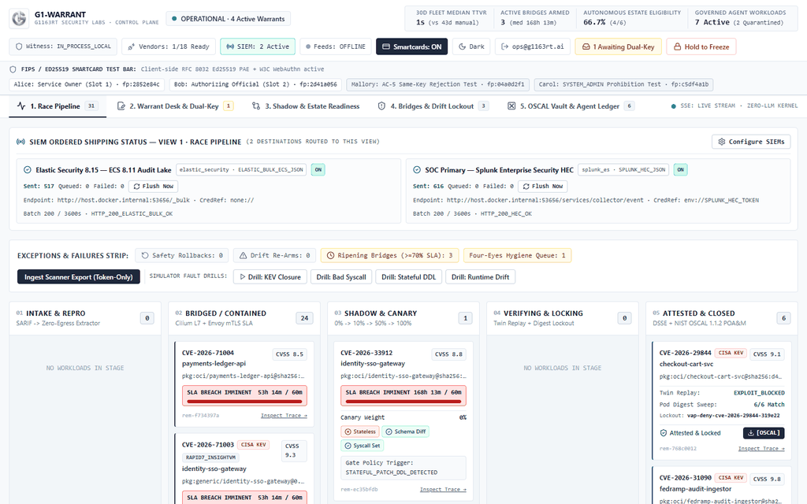
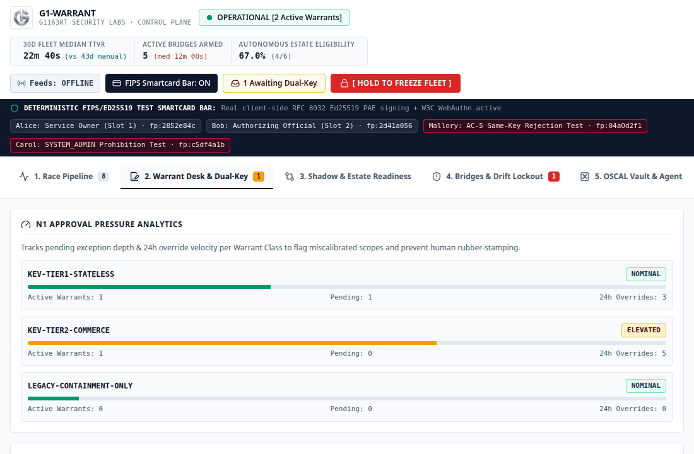
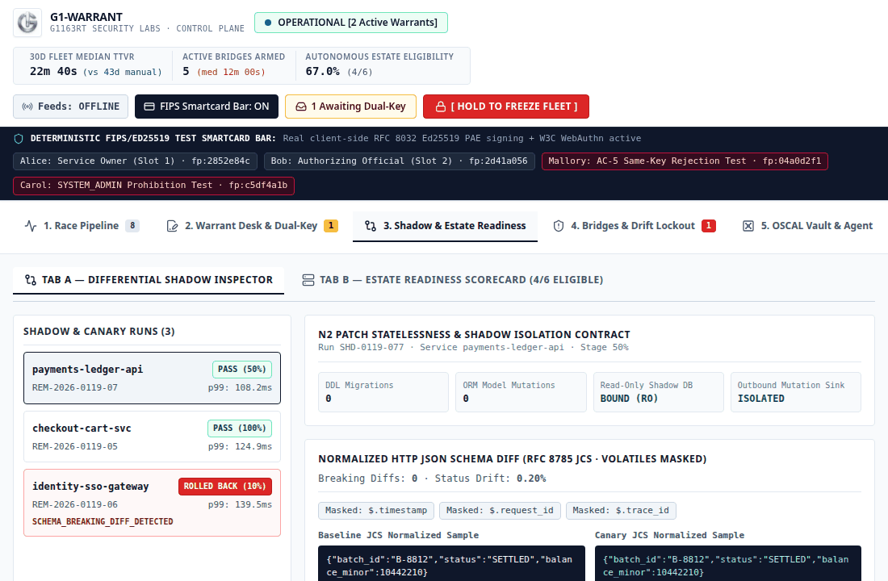
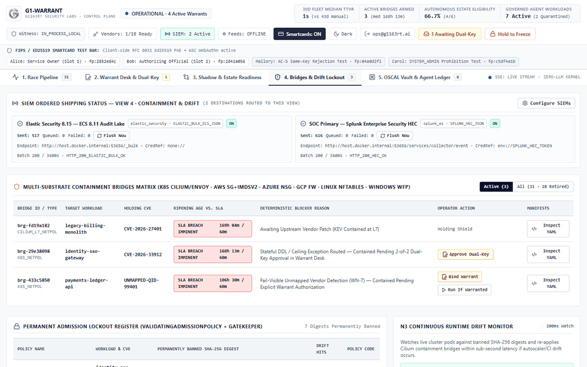
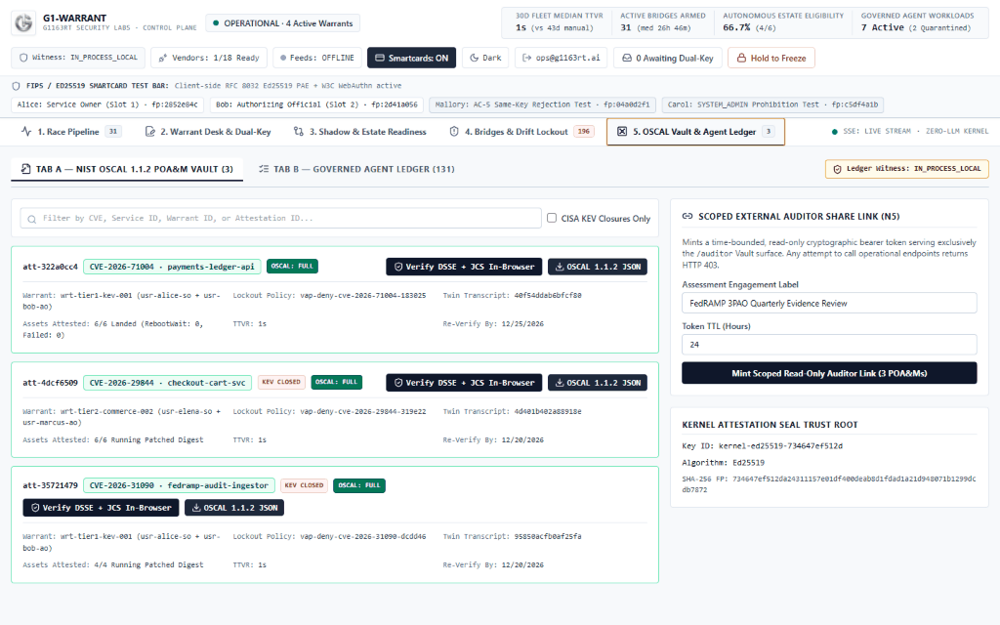
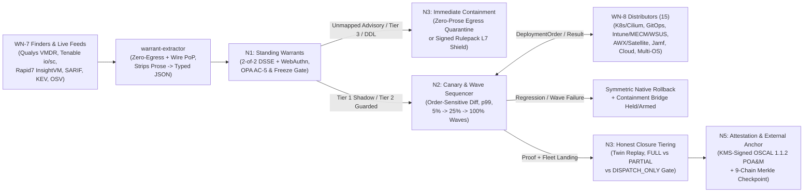

<p align="center">
  
</p>

# G1-Warrant — by G1163RT Security Labs

[](https://github.com/cgilbert61/G1-Warrant/actions/workflows/ci.yml)
[](https://github.com/cgilbert61/G1-Warrant/actions/workflows/federal-devsecops.yml)
[](LICENSE)
[-brightgreen.svg)](THIRD_PARTY_LICENSES.md)
[-00ADD8.svg)](go.mod)
[-3776AB.svg)](sdk/python/)
[](policies/)
[](docs/govready_compliance_assessment_report.md)
[](docs/federal_devsecops_compliance_report.md)
[](reports/axe-accessibility.json)

**Deterministic Autonomous Remediation, Virtual Containment & NIST OSCAL 1.1.2 Attestation Control Plane (`v1.3.0`) — G1163RT Security Labs, Inc.**

> **Core Operational Principle:** **Contain in seconds; verify and roll out safely in minutes.**

---

## What Is G1-Warrant & What Problem Does It Solve?

**G1-Warrant** is a deterministic remediation, containment, and cryptographic attestation control plane built to outpace autonomous/agentic intrusions—enforcing KEV-driven remediation, egress/metadata quarantine, and externally Merkle-anchored cryptographic audit trails across production execution environments.

> **Threat Context:** Standard perimeter and IAM controls fail when compromised workloads or autonomous agents inherit ambient credentials and unrestricted metadata/egress paths. G1-Warrant exists to enforce hard, fail-closed execution boundaries against active exploitation patterns—specifically addressing the attack primitives detailed in **FBI Flash Advisory `FLASH-20261113-001` (`ARTEX`)**—without relying on probabilistic detection.

Modern vulnerability scanners (`Qualys VMDR`, `Tenable.io` / `Tenable.sc`, `Rapid7 InsightVM`, `Wiz`, `Trivy`, `Semgrep`, `Snyk`) and threat feeds (`CISA KEV`, `Google OSV.dev`) detect critical vulnerabilities in **seconds**, and upstream build pipelines or automated fix generators can produce signed candidate patches in **minutes**. Yet across enterprise and federal production estates, the median time to remediate a Known Exploited Vulnerability (`KEV`) remains **43 days**.

Remediation stalls in that merge-to-production gap for four structural reasons:

1. **No Pre-Negotiated Authority:** Autonomous tools cannot safely push production changes because security teams and service owners lack a cryptographic contract to pre-authorize *bounded* action ahead of an incident.
2. **All-or-Nothing Rollout Cliffs:** Traditional automation either pushes patches blindly without statistical canary dwell/sampling or blocks brownfield workloads behind manual Change Advisory Boards (`CAB`).
3. **Blind Virtual Patching vs. Unprotected Exposure:** Guessing application HTTP routes from stripped CVE prose causes self-inflicted L7 outages, while doing nothing leaves unpatched pods exposed to reverse shells, cloud metadata harvesting, and callback exploitation during review.
4. **Unverified "Paper" Closures & Broken PoC Traps:** Closing tickets when a PR merges—or when an unverified exploit script fails against an unpatched target—creates false assurance without proving live pod SHA-256 digest convergence, enforcing cluster admission lockouts, or sealing **NIST OSCAL 1.1.2 POA&M** evidence for 3PAO auditors.

**G1-Warrant** (`warrantd` server, `warrant` Go CLI, `pkg/warrantsdk` Go SDK, `g1-warrant-sdk` Python SDK/CLI, `warrant-extractor`, and the 5-View G1-Warrant Console) sits between incumbent enterprise scanners/feeds (`WN-7` Finders) and heterogeneous production deployment systems (`WN-8` Distributors across Kubernetes/Cilium, GitOps, Windows, Linux, macOS, and Cloud)—**containing active exposure in seconds and verifying governed rollouts safely in minutes**, with **zero LLM inference inside the safety kernel**.

---

## Incumbent Integration Architecture (`v1.2.0` — 18 Vendor Translators)

> **Proof Tier & Verification Fence:** `LiveKubernetesAdapter` (`WARRANT_CLUSTER_DRIVER=kubernetes`) and the `v1.3.0` 3-Clone `CONTAINER_TWIN` Proving Ground (`g1-twin-proving`) have been **executed end-to-end against a real disposable `k3s` Kubernetes cluster** (`scripts/run_disposable_cluster_f3_proof.py`, closing `F3`). By contrast, the 4 non-Docker `VM_TWIN` QA Clone drivers (`hyperv`, `aws-ec2`, `azure-vm`, `gcp-gce`), the 3 `WN-7` commercial Finder translators, and the 14 non-Kubernetes `WN-8` Distributor translators are verified against deterministic invariant tests (`TestInvariant15`–`TestInvariant19`), wire-PoP mock HTTP servers, and recorded/sandbox sessions; **none of those external vendor/cloud/Hyper-V VM targets has yet run against live cloud tenant credentials or an elevated Hyper-V golden `.vhdx` host** (and when `WARRANT_VM_TWIN_DRIVER` is unset, `KERNEL` and `BOOT_LAYER` patches fail closed with `KERNEL_PATCH_REQUIRES_VM_TWIN_RUNTIME`). Output from `/warrant distributors list` (and `GET /api/v1/distributors`) confirms translator registration in the control-plane registry; it does **not** confirm an authenticated conversation with a live vendor API.

### Inbound Finders (`WN-7` — 3 Vendor Translators + Open Standards)

All inbound scan exports terminate inside zero-egress `warrant-extractor` (`POST /extract/{qualys,tenable,rapid7,sarif,secrets}` under `X-Warrant-Task-DSSE` + `X-Warrant-Agent-PoP`), stripping 100% of scanner prose, HTML, markdown, and prompt-injection payloads before crossing into `warrantd`:

1. **Qualys VMDR (`qualys_vmdr`)** — XXE-hardened Host Detection XML (`<HOST_LIST_VM_DETECTION_OUTPUT>`) and JSON v2 (`QID-*` detections, severity/CVSSv3, `CVE-*` / `CWE-*`, `KB` / package hints, and fail-visible `UNMAPPED-QID-*` routing).
2. **Tenable (`tenable` — `Tenable.io` & `Tenable.sc`)** — Vulnerability Export JSON & `Tenable.sc` analysis payloads (`PLUGIN-*` IDs, asset UUID / EC2 instance / FQDN alias resolution, VPR/CVSSv3, and fail-visible `UNMAPPED-PLUGIN-*` routing).
3. **Rapid7 InsightVM (`rapid7_insightvm`)** — InsightVM v3 Asset-Vulnerability JSON (`R7-*` check normalization, CVSSv3/v2 + bounded risk-score fallback, and fail-visible unmapped check routing).

*(Plus built-in open-schema parsers for `SARIF 2.1.0` [`Wiz`, `Trivy`, `Semgrep`, `Snyk`], `CISA KEV`, `Google OSV.dev`, and `Gitleaks` / `GitGuardian` secret scans.)*

### Outbound / Inbound Mirror Distributors (`WN-8` — 15 Registered Translators Across 6 Families)

Every distributor implements `DistributorTranslator` (`DispatchOrder`, `PollResult`, `ExecuteRollback`), translating canonical `DeploymentOrder` and `DeploymentResult` records under `agt-distributor-gateway` wire PoP:

| Family | Distributor (`distributor_id`) | Ring Sequencing | Evidence & Default Symmetric Rollback |
| :--- | :--- | :--- | :--- |
| **Containers & GitOps** | **1. Kubernetes with Cilium** (`k8s-cilium-native`) *(adapter predates `v1.2.0`; now registered as a `DistributorTranslator` like the rest)* | Native progressive canary | Per-pod digest verified · Pin previous OCI digest |
| **Containers & GitOps** | **2. Argo CD** (`argocd`) | Native sync waves | Per-resource health · Application history rollback |
| **Containers & GitOps** | **3. Flux** (`flux`) | Warrant-sequenced (`5% → 25% → 100%`) | `DISPATCH_ACK_ONLY` (`Tier 0`) · Git revert commit |
| **Microsoft Estate** | **4. Microsoft Intune** (`ms-intune`) | Native Windows Update rings | Per-device Graph state (`LANDED` / `REBOOT_WAITING`) · Expedited KB uninstall |
| **Microsoft Estate** | **5. Microsoft Configuration Manager** (`ms-mecm`) | Native phased deployments | Per-device compliance · `wusa.exe /uninstall` deployment |
| **Microsoft Estate** | **6. Microsoft WSUS** (`ms-wsus`) | Warrant-sequenced (`5% → 25% → 100%`) | Per-computer target group report · WSUS decline + `wusa /uninstall` |
| **Linux Automation** | **7. Ansible (`AWX`)** (`ansible-awx`) | Warrant-sequenced (`5% → 25% → 100%`) | Per-host `/job_events/` (`runner_on_ok` / `reboot_required`) · Playbook NEVRA downgrade |
| **Linux Automation** | **8. Red Hat Satellite** (`redhat-satellite`) | Warrant-sequenced (`5% → 25% → 100%`) | Per-host Katello remote execution · `dnf history undo` / content-view revert |
| **Apple Estate** | **9. Jamf Pro** (`jamf-pro`) | Warrant-sequenced (`5% → 25% → 100%`) | Per-macOS computer policy log · Policy disable + previous `.pkg` revert |
| **Cloud Patchers** | **10. AWS Systems Manager** (`aws-ssm`) | Native `MaxConcurrency` / `MaxErrors` | Per-instance `AWS-RunPatchBaseline` status · SSM rollback document |
| **Cloud Patchers** | **11. Azure Update Manager** (`azure-update-manager`) | Native maintenance configurations | Per-VM assessment/install result · Azure VM Run Command rollback |
| **Cloud Patchers** | **12. Google Cloud OS Config** (`gcp-os-config`) | Native rolling zone/percent disruption budget | Per-instance OS patch job compliance · OS Config exec-step rollback |
| **Multi-Platform Patch** | **13. Tanium Patch** (`tanium-patch`) | Native deployment rings | Per-endpoint patch status · Tanium uninstall action |
| **Multi-Platform Patch** | **14. Ivanti Neurons** (`ivanti-neurons`) | Native staged rings | Per-device deployment telemetry · Ivanti rollback package bundle |
| **Multi-Platform Patch** | **15. Automox** (`automox`) | Warrant-sequenced (`5% → 25% → 100%`) | Per-device policy execution event · Remediation worklet revert |

---

## Operator Console Overview

### 1. 5-Stage Autonomous Race Pipeline & Live Fleet Drills
Real-time visibility across `01 INTAKE & REPRO` → `02 BRIDGED / CONTAINED` → `03 SHADOW & CANARY` → `04 VERIFYING & LOCKING` → `05 ATTESTED & CLOSED`, with instant safety rollbacks, drift re-arm counters, and deterministic fleet drills.



### 2. Warrant Desk, Dual-Key Ceremonies & Approval Pressure Analytics (`N1`)
Tracks `2-of-2` Standing Warrants (`SERVICE_OWNER` + `AUTHORIZING_OFFICIAL`), hardware WebAuthn/Ed25519 signing ceremonies, Four-Eyes exception queues, and per-class approval pressure velocity to prevent scope miscalibration and rubber-stamping.



### 3. Differential Shadow Inspector & Estate Readiness Scorecard (`N2`)
Evaluates progressive canary rollouts using order-sensitive JSON payload diffing (with explicit `unordered_array_paths` opt-ins), `p50/p95/p99` latency bounds, eBPF syscall/file/egress guards, and the 5-Gate 3-Tier Graduated Estate Readiness Scorecard (`readOnlyRootFilesystem` + `noexec /tmp`).



### 4. Containment Bridges Matrix & Sub-Second Runtime Drift Lockout (`N3`)
Manages active CiliumNetworkPolicy, Kubernetes NetworkPolicy, and Envoy SPIFFE mTLS containment shields (`169.254.169.254` metadata & `kube-apiserver` quarantine) alongside `ValidatingAdmissionPolicy` image lockouts and automatic sub-second bridge re-arming upon runtime drift.



### 5. NIST OSCAL 1.1.2 POA&M Vault & Governed Agent Ledger (`N4` & `N5`)
Seals every verified closure into a DSSE-signed **NIST OSCAL `1.1.2` POA&M** bundle with one-click JSON export and client-side in-browser `RFC 8785 JCS` + `Ed25519` cryptographic verification alongside the hash-chained Governed Agent Ledger.



---

## Architectural Flow & 5 Control-Plane Engines (`N1–N5`)



### Non-Negotiable Architectural & Production SRE Invariants

1. **100% Deterministic Safety Kernel (`Zero LLM Inference` in `N1–N5` or Console):** Policy evaluation (`OPA Rego v1`), statistical canary gating, differential twin verification, OSCAL attestation minting, and Console rendering are strictly deterministic state machines and cryptographic verifiers. External AI/LLM fix generators operate solely outside the kernel as untrusted workers governed by `N4`.
2. **Dual-Key Standing Warrants, Quorum Survivor Floor & Non-Repudiable Governance (`N1` — `NIST SP 800-53 Rev 5 AC-5`, `IA-2`, `AU-10`):**
   - Every automated rollout or containment action executes under a **Standing Warrant** carrying **`2-of-2` human cryptographic signatures** (`Slot 1: SERVICE_OWNER` + `Slot 2: AUTHORIZING_OFFICIAL`) over `RFC 8785 JCS` canonicalized `DSSEv1` envelopes via `Ed25519` or **W3C WebAuthn hardware authenticators** (`FIDO2` / `PIV`), enforcing unique public-key SHA-256 fingerprints across `principals` and blocking re-enrollment of revoked keys.
   - `WARRANT_BOOTSTRAP_ADMIN_TOKEN` is **strictly genesis-only (one-shot)**: once sealed via `POST /api/v1/bootstrap/seal` (`warrant principals seal`) or automatically upon the first `POST /api/v1/warrants` submission, single-token enrollment is permanently rejected (`HTTP 403 BOOTSTRAP_SEALED_REQUIRES_DUAL_KEY_DSSE`) and future principal enrollments (`ENROLL_PRINCIPAL` across Ed25519 and WebAuthn) require a **`2-of-2` DSSE Principal Governance envelope** (`<= 15m` TTL + single-use `envelope_id`).
   - **Self-Only `1-of-2` Revocation, Backup-Assassination Defense & Production Quorum Floor (`v1.0.3`):** To prevent a stolen primary key from burning cold-storage vault backups, `1-of-2` `REVOKE_PRINCIPAL` is restricted **strictly to self-revocation** (`signer.PrincipalID == target.PrincipalID`, while preserving the `>= 1` active `SERVICE_OWNER` + `>= 1` active `AUTHORIZING_OFFICIAL` survivor floor inside serialized `pg_advisory_xact_lock` transactions). Revoking any peer principal (`signer != target`) requires a **`2-of-2` DSSE ceremony** (`REVOKE_PRINCIPAL` or atomic `ROTATE_AND_REVOKE_PRINCIPAL` co-signed by `SO + AO`, rejecting `1-of-2` peer revocation with `HTTP 403 PEER_REVOCATION_REQUIRES_DUAL_KEY_DSSE`), and `kubernetes` / `live` deployments require `>= 2` active `SO` + `>= 2` active `AO` before genesis bootstrap sealing (`>= 1 SO + >= 1 AO` in offline `simulator` mode).
   - **WebAuthn P-256 Operator Parity, Raw-Byte Request Binding & Automation Isolation (`v1.0.3`):** `VerifySingleActivePrincipalCeremony` validates both `Ed25519` and **`W3C WebAuthn P-256` (`ES256`)** hardware assertions across `freeze`, `emergency-rollback`, `auditor-tokens`, and self-revocation; every `1-of-2` DSSE governance header signs canonical `http_method`, `canonical_path`, `request_body_sha256` computed over **exact raw wire bytes** prior to JSON unmarshaling, `expires_at` (`<= 5m` ceiling), and a single-use `envelope_id` (`HTTP 401 DSSE_REQUEST_SCOPE_OR_NONCE_VIOLATION`); `2-of-2` `THAW` ceremonies bind to monotonic `system_freeze_state.freeze_epoch`; and `WARRANT_AUTOMATION_TOKEN` is scoped strictly to `POST /api/v1/feeds/*` and `POST /api/v1/ledger/checkpoints` (`HTTP 403 AUTOMATION_TOKEN_FORBIDDEN_ON_HUMAN_GOVERNANCE_ROUTE` on human routes).
   - Production SDKs and CLIs ship **zero hardcoded demo signers**, emit split `<name>.priv.json` (`0600`) and `<name>.pub.json` (`0644`) key files, redact sandbox personas by default (`WARRANT_ENABLE_TEST_SMARTCARDS=false`), and fail closed (`os.Exit(1)`) at startup if test smartcards or weak/placeholder secrets are configured alongside `WARRANT_CLUSTER_DRIVER=kubernetes` or `WARRANT_FEED_MODE=live`.
3. **Zero-Prose Quarantine vs. Publisher-Signed L7 Rulepacks (`N3` & `N4` — `SC-7(5)`):**
   - `warrant-extractor` strips untrusted `SARIF`/`KEV`/`OSV` prose inside a zero-egress container. Because stripped telemetry lacks custom application route semantics, `N3` **never guesses HTTP routes**.
   - By default, `N3` enforces **`ZERO_PROSE_EGRESS_MESH_QUARANTINE`**—cutting external world egress and Kubernetes API access (`toEntities: ["world", "kube-apiserver"]`, unless Kubernetes API egress is explicitly declared via `allow_kube_apiserver_egress`) to block reverse shells, JNDI callbacks, and in-cluster API pivoting while preserving authenticated internal mTLS mesh traffic without causing blind L7 outages.
   - Targeted Envoy/Cilium HTTP path/header virtual patches (**`SIGNED_RULEPACK_L7_SHIELD`**) are applied *only* when an Ed25519 publisher-signed CWE/CVE `SignedVirtualPatchRulepack` matches in `RulepackRegistry`.
4. **3-Tier Graduated Fleet Autonomy & Order-Sensitive Canary Diffing (`N2` — `CM-2`, `CM-3(4)`):**
   - Replaces rigid binary coverage cliffs with **three graduated tiers**: **`TIER_1_FULL_AUTONOMOUS`** (`>= 80%` coverage + OTel probes + ephemeral CoW/shadow DB + verified rollback + immutable rootfs), **`TIER_2_GUARDED_CANARY`** (brownfield services with OTel SLI probes + `< 10s` rollback hooks + immutable rootfs when authorized by `allow_guarded_canary`), and **`TIER_3_CONTAIN_AND_CAB`** (automatic L3/L4 egress quarantine + Four-Eyes CAB).
   - Enforces configurable `min_canary_samples` and `stage_dwell_seconds` on Standing Warrants, blocks mutating traffic from hitting read-only replicas, compares HTTP JSON payloads **strictly order-sensitively by default** so `ORDER BY`, pagination, and financial ledger sequence bugs are caught (restricting multiset order-insensitive array comparison solely to explicit per-service `unordered_array_paths` opt-ins), applies `1e-6` floating-point epsilon tolerance and custom `volatile_json_paths` masks, and monitors **in-process file reads** (e.g., `serviceaccount/token`) and **unexpected egress** alongside `execve` syscalls.
5. **Differential Twin Positive Control & Dual Assurance Tiers (`N3` & `N5` — `RA-5`):**
   - Prevents broken exploit scripts from producing false-negative closures: **`ASSURANCE_TIER_2_DIFFERENTIAL_TWIN`** requires positive-control confirmation that the signed probe **succeeds** against `vulnerable_digest` (`unpatched_twin_status == "EXPLOIT_SUCCEEDED"`) AND **is blocked** against `patched_digest` (`twin_replay_status == "EXPLOIT_BLOCKED"`).
   - For standard `Trivy`/`OSV`/`KEV` advisories without weaponized PoCs, `warrantd` closes honestly at **`ASSURANCE_TIER_1_PASSIVE_DIGEST_SBOM`** relying strictly on verifiable cluster and build artifacts (**Ed25519 publisher provenance + 100% live pod `imageID` SHA-256 digest convergence + vulnerable package absence in SBOM + enforced cluster admission lockout**) and records the exact assurance tier inside the minted **NIST OSCAL 1.1.2 POA&M**.
6. **Atomic 3-Step `QUARANTINED_ROLLBACK` (`Contain-Before-Unban`) & Resilient Streaming K8s `WATCH` (`N3` — `CA-7`):**
   - Resolves the post-closure latent regression vs. `ValidatingAdmissionPolicy` lockout collision via `POST /api/v1/pipeline/{id}/emergency-rollback`: **(1)** re-arms the `N3` containment bridge *first*, **(2)** suspends the `ValidatingAdmissionPolicy` (`SUSPENDED_FOR_QUARANTINED_ROLLBACK`), and **(3)** rolls pods back to the previous digest under active quarantine.
   - `LiveKubernetesAdapter` (`WARRANT_CLUSTER_DRIVER=kubernetes`) uses chunked **`kube-apiserver` `WATCH` streams** (`?watch=true&allowWatchBookmarks=true&resourceVersion=...`) with idle read timeouts and automatic full `LIST` catch-up re-syncs upon `HTTP 410 Gone` (`Expired` `resourceVersion`) instead of high-frequency polling.
7. **Non-Exportable KMS Signing, Attested Authority Lineage & External Merkle Anchor (`N5` — `AU-9(3)`, `SR-11`):**
   - Abstracts attestation and task signing behind `crypto.EnvelopeSigner` (`RemoteKMSSigner` via `WARRANT_KMS_SIGN_URL` for Vault Transit / Cloud KMS / HSM, or volume-persisted `0600` `WARRANT_KERNEL_KEY_PATH` so routine non-KMS container restarts retain `seq_no = 1` without unattested key churn), while enforcing **with zero exemptions** that every `kernel_public_keys` row with `seq_no > 1` carries a valid `rotation_dsse` signed by the preceding (`seq_no - 1`) kernel key or a `2-of-2` human Principal Governance `ROTATE_KERNEL_KEY` DSSE envelope.
   - Seals genesis bootstrap with a kernel-signed **Genesis Seal Manifest** (`bootstrap_state.genesis_seal_dsse`), immediately triggers **External Merkle `Checkpoint #0`** inside `SealBootstrap` (on explicit seal and first-warrant auto-seal), and persists the authorizing DSSE Governance Envelope (`governance_dsse` + total-order `authority_seq`) on every post-seal `principals` and `principal_revocations` row—replaying full authority lineage inside both `VerifyAllLedgerChains` and pre-checkpoint `AnchorCheckpoint` (`UNATTESTED_AUTHORITY_LINEAGE_INSERT_DETECTED`).
   - Enforces PostgreSQL `BEFORE UPDATE OR DELETE` immutability triggers, transaction-locked SHA-256 hash chaining, and **`TransparencyAnchor` 6-Chain Combined Merkle Root checkpoints** across all 6 security-critical tables (`warrant_envelopes`, `agent_action_ledger`, `attestation_records`, `principals`, `principal_revocations`, and `kernel_public_keys`), shipping DSSE-signed checkpoints to `WARRANT_EXTERNAL_ANCHOR_URL` (with `WARRANT_EXTERNAL_ANCHOR_PATH` for local sandboxes).
8. **Workload Containment, Credential Rotation & Internal Patch-Pipeline Hygiene (`N1–N4`):**
   - *Note on Scope:* G1-Warrant is a deterministic remediation, workload containment, and attestation kernel—it is **not** a SIEM or cloud IAM behavioral log-detection engine.
   - **`SECRET-ROTATION-STATELESS` Standing Warrant (`N1`, `N3` & `N4`):** `warrant-extractor` (`POST /extract/secrets`) ingests Gitleaks (JSON & SARIF 2.1.0) and GitGuardian secret-exposure findings, irreversibly hashes exposed credentials into SHA-256 fingerprints while stripping all plaintext secrets, rotates Kubernetes `ExternalSecret` / `ServiceAccount` credentials + triggers rolling restarts (`POST /api/v1/intake/secrets`), and enforces a cryptographic non-equivalence check (`rotated_secret_sha256 != exposed_secret_sha256` and non-empty) before minting `ASSURANCE_TIER_SECRET_ROTATED`—failing closed under quarantine if the upstream secret manager has not yet rotated the underlying secret value.
   - **Default Cloud Metadata (`169.254.169.254`) & Callback Quarantine (`N3`):** Every `N3` Cilium/NetworkPolicy containment bridge automatically blocks cloud instance metadata (`169.254.169.254/32`, `169.254.170.2/32`, `fd00:ec2::254/128`), `kube-apiserver` (unless explicitly declared), and external callbacks (`toEntities: ["world"]`), restricting egress strictly to pre-declared internal cluster services while keeping production ingress online.
   - **Mandatory Immutable RootFS Gate (`N2`) & Authenticated Tetragon In-Pod Drift Quarantine (`N3`):** Enforces `readOnlyRootFilesystem: true` + `noexec /tmp` (`IMMUTABLE_ROOTFS_NOEXEC_TMP`) as a **mandatory 5th gate** on the `N2` Estate Readiness Scorecard, and requires dedicated sensor authentication (`WARRANT_TETRAGON_SENSOR_TOKEN` / `WARRANT_TETRAGON_HMAC_SECRET`, distinct from operator and `g1aud_*` auditor tokens) on `POST /api/v1/telemetry/tetragon` to catch container filesystem writes and untracked processes on valid-digest pods—re-arming quarantine, cordoning the compromised pod, and recycling a clean replica without exposing a pod-eviction DoS vector.
   - **Attack-Path Chained CWE Weighting (`N1`) & Internal Patch-Pipeline Supply-Chain Hygiene (`N4`):** Elevates chained CWEs (`CWE-209`, `CWE-918`, `CWE-434`) via `auto_remediate_cwes` even below CVSS 7.0 floors. For internal patch-pipeline supply-chain hygiene against untrusted upstream fix-generator diffs, `N4` normalizes every diff path (`path.Clean`, rejecting `..` traversal and git `120000` symlinks) and blocks mutations to protected build and coding-agent files (`Dockerfile*`, `Makefile`, `GNUmakefile`, `AGENTS.md`, `CLAUDE.md`, `.github/`, `.gitlab-ci*`, `.cursor/`, `.gemini/`) at **any** directory depth (`SECURITY_VIOLATION: FORBIDDEN_BUILD_OR_AGENT_CONFIG_MUTATION`).
9. **Agent Workload Identity, Commissioning Function Governance, IGA Orphan Quarantine & RFC 8693 Wire PoP (`N1` & `N4` — `v1.1.0`):**
   - Enforces **3-Way `Builder != Commissioner` Separation of Duties** (`G1_AGENT_PROVENANCE_V1` signed by build attestors, commissioned separately by `SERVICE_OWNER` + `AUTHORIZING_OFFICIAL` under a `CommissioningFunction`), backup-sponsor continuity on HR transfers/reorgs with bounded orphan grace windows and `0s` `KEY_COMPROMISE` cutoff, `OPA` wire-level permission intersection (`StandingWarrantScope ∩ AgentCapabilityCeiling ∩ ParentTaskScope ∩ RequestedTask`), holder-of-key `cnf` + nested `act` `EphemeralTaskWarrant` token exchange (`X-Warrant-Task-DSSE` + `X-Warrant-Agent-PoP`), and **9-Chain Combined Merkle Root (`v3`)** anchoring.
10. **Two-Contract Incumbent Integration & Honest Per-Asset Closure (`WN-7` & `WN-8` — `v1.2.0`):**
    - *"The ends belong to incumbents; the middle is the product."* Every external scanner terminates inside zero-egress `warrant-extractor` into canonical `ExtractedFindingSet` (`WN-7`), surfacing unmapped vendor advisories fail-visibly (`UNMAPPED_FINDING_REQUIRES_CLASS_BINDING`) behind armed containment rather than dropping them silently. Every patch deployment tool translates between WORM-protected `DeploymentOrder` (persisting `NativeRollbackSpec` **before Wave 1 fires** and refusing execution without both a scoped `2-of-2` Standing Warrant and passing `N3` proof — `NO_PROOF_NO_DEPLOYMENT_ORDER`) and per-asset `DeploymentResult` (`WN-8`), enforcing honest `FULL` vs. `PARTIAL` (bridge held armed) vs. `DISPATCH_ONLY` (`ASSURANCE_TIER_0_DISTRIBUTOR_DISPATCH_ONLY`, bridge held armed) OSCAL closure.
11. **Zero-Signature Intake Doctrine, 3-Clone Proving Ground (`Kubernetes` + `Hyper-V` / `AWS` / `Azure` / `GCP` `VM_TWIN`) & Light/Dark Console (`v1.3.0`):**
    - **Zero-Signature Intake (`TestInvariant18`):** Findings (`Qualys`, `Tenable`, `Rapid7`, `SARIF`, `Secrets`) arrive on `X-Warrant-Intake-Token` alone across REST APIs, Go CLI (`warrant intake ... --intake-token`), Python CLI (`g1-warrant finder-intake ... --intake-token`), and the Console's **Ingest Scanner Export (Token-Only)** panel (which also includes a persistent **Light / Dark Mode** toggle across all 5 Console views and the 3PAO Auditor Portal). Dual-key (`Slot 1` + `Slot 2`) is never requested at ingest; unmapped or unbound findings arm containment autonomously (`StatusHealth = "BRIDGED"`, `ClassBindingStatus = "UNBOUND"`, `0` Four-Eyes Queue rows) until decoupled class binding (`POST /api/v1/remediations/{id}/bind-class`).
    - **3-Clone Proving Ground & Runtime-Follows-Patch (`F3` Closed + `TestInvariant19`):** Before any `N2` canary wave or `WN-8` distributor order fires, `N3` clones **3 isolated replicas** of the workload (`g1-twin-proving` namespace on Kubernetes for `CONTAINER_TWIN`, executed end-to-end on real `rancher/k3s` via `python scripts/run_disposable_cluster_f3_proof.py`) and verifies **(a)** services-up readiness, **(b)** workload smoke tests, and **(c)** Standing Warrant class acceptance checks with zero per-run human signatures. For non-Docker QA estates (`WARRANT_VM_TWIN_SERVICES`) and **`KERNEL` / `BOOT_LAYER`** patches (which require real OS reboots), `WARRANT_VM_TWIN_DRIVER` ships wire-accurate drivers for **`hyperv`** (Differencing `.vhdx` + `Private` switch + `Copy-VMFile`/PowerShell Direct via `scripts/hyperv_vm_twin_agent.ps1` once granted `Hyper-V Administrators`), **`aws-ec2`** (pure-Go AWS SigV4 + EC2 `2016-11-15` XML + SSM `exit 194`/`3010` reboot), **`azure-vm`** (Entra ID OAuth2 + ARM `2024-03-01` `deleteOption=Delete` + `202` LRO polling + `restart` + `runCommand`), and **`gcp-gce`** (Service Account RS256 JWT / Metadata + Compute Engine v1 + serial-port reboot verification), failing closed with `KERNEL_PATCH_REQUIRES_VM_TWIN_RUNTIME` when unconfigured.

---

## Quick Start (Zero Host Toolchains Required)

```bash
# Option A — Interactive Evaluation Sandbox (seeds 6 workloads, sandbox PIV personas, Standing Warrants & Console drills)
docker compose -f docker-compose.yml -f docker-compose.demo.yml up --build -d

# Option B — Clean-Room AC-5 Mode (6 simulator workloads seeded; 0 demo signers/warrants; one-shot genesis token)
WARRANT_BOOTSTRAP_ADMIN_TOKEN="$(openssl rand -hex 24)" docker compose up --build -d

# Open the embedded 5-View G1-Warrant Console (W3C WebAuthn localhost enabled)
#   -> http://localhost:8080

# Inspect live control-plane posture & 6-chain cryptographic ledger health via the embedded Go CLI
docker compose exec warrantd /warrant status
docker compose exec warrantd /warrant ledger verify
```

> **Production Kubernetes Cluster Handoff (`k8s/`):** To point `warrantd` at a live Kubernetes + Cilium cluster instead of `fleet-sim` (`/api/v1/simulate/*` fault-injection drills are automatically disabled in `kubernetes` and `live` feed modes):
> - `WARRANT_CLUSTER_DRIVER=kubernetes` (uses in-cluster SA mounts or `WARRANT_KUBE_API_URL`), `WARRANT_TETRAGON_SENSOR_TOKEN=<sensor-secret>`, `WARRANT_INTAKE_TOKEN=<scanner-intake-secret>`, and optional `WARRANT_AUTOMATION_TOKEN=<cron-feed-anchor-secret>`
> - `WARRANT_KMS_SIGN_URL=https://<vault-or-kms-proxy>/v1/sign` and `WARRANT_KMS_PUBLIC_KEY_B64=<ed25519-pub-b64>`
> - `WARRANT_EXTERNAL_ANCHOR_URL=https://<rekor-or-s3-object-lock-webhook>/anchor` and one-shot `WARRANT_BOOTSTRAP_ADMIN_TOKEN=<genesis-registrar-secret>` (auto-disabled after seal)

### Optional Zero-Cost Live Threat & Scanner Feeds (`offline` Enclave Default vs. `live`)

By default, `WARRANT_FEED_MODE=offline` keeps G1-Warrant 100% air-gapped for federal enclaves and deterministic CI runs. To pull **live US Government CISA KEV bulletins (`cisa.gov`)**, **Google OSV.dev SBOM advisories (`api.osv.dev`)**, and **live `aquasec/trivy` container `SARIF 2.1.0` scans** (authenticated via `WARRANT_INTAKE_TOKEN` and sanitized through `warrant-extractor`):

```powershell
# Windows PowerShell
$env:WARRANT_FEED_MODE="live"; $env:WARRANT_TRIVY_ENABLED="true"; $env:WARRANT_INTAKE_TOKEN="g1-intake-$([guid]::NewGuid().ToString('N'))"; $env:WARRANT_BOOTSTRAP_ADMIN_TOKEN="g1-genesis-$([guid]::NewGuid().ToString('N'))"; docker compose --profile live-feeds up --build -d
```

```bash
# Linux / macOS
WARRANT_FEED_MODE=live WARRANT_TRIVY_ENABLED=true WARRANT_INTAKE_TOKEN="$(openssl rand -hex 24)" WARRANT_BOOTSTRAP_ADMIN_TOKEN="$(openssl rand -hex 24)" docker compose --profile live-feeds up --build -d
```

---

## Official SDKs & Command-Line Interfaces (`Go` & `Python`)

G1-Warrant provides both a **Pure-Go Client SDK (`pkg/warrantsdk`) + `warrant` CLI** and a **Standalone Python Client SDK (`sdk/python` / `g1-warrant-sdk`) + `g1-warrant` CLI**. Full API and ceremony documentation is available in [`docs/sdk_and_cli_guide.md`](docs/sdk_and_cli_guide.md), and complete vendor API configuration details for all **18** `WN-7` Finder and `WN-8` Distributor integrations are documented in [`docs/vendor_integration_reference.md`](docs/vendor_integration_reference.md).

### 1. Native `warrant` CLI (`cmd/warrant`)

```bash
# Build locally (or invoke via `docker compose exec warrantd /warrant ...`)
go build -o warrant ./cmd/warrant

# Inspect live fleet scoreboard, warrants, race pipeline & graduated autonomy tiers
./warrant status
./warrant warrants list
./warrant pipeline list
./warrant estate

# Generate split AC-5 Ed25519 keypairs (<name>.priv.json [0600] + <name>.pub.json [0644 public-only])
./warrant keygen --id usr-so-01 --email so@agency.gov --role SERVICE_OWNER --out so-key
./warrant keygen --id usr-ao-01 --email ao@agency.gov --role AUTHORIZING_OFFICIAL --out ao-key

# One-shot genesis enrollment using ONLY .pub.json (private keys never touch network subcommands)
./warrant principals register --pub so-key.pub.json --admin-token "$WARRANT_BOOTSTRAP_ADMIN_TOKEN"
./warrant principals register --pub ao-key.pub.json --admin-token "$WARRANT_BOOTSTRAP_ADMIN_TOKEN"
./warrant principals seal --admin-token "$WARRANT_BOOTSTRAP_ADMIN_TOKEN"

# Draft, 2-of-2 co-sign, and submit an RFC 8785 JCS Standing Warrant DSSE envelope (also auto-seals bootstrap)
./warrant warrants draft --class KEV-TIER1-STATELESS --services payments-ledger-api --out warrant.dsse.json
./warrant warrants sign --in warrant.dsse.json --slot 1 --key so-key.priv.json
./warrant warrants sign --in warrant.dsse.json --slot 2 --key ao-key.priv.json
./warrant warrants submit warrant.dsse.json

# Post-seal enrollment requires 2-of-2 DSSE co-signatures; emergency rollback uses request-scoped 1-of-2 DSSE/WebAuthn;
# 1-of-2 revocation is strictly self-revocation (preserving >=1 SO & >=1 AO); peer revocation uses 2-of-2 DSSE
./warrant keygen --id usr-so-02 --email so-backup@agency.gov --role SERVICE_OWNER --out so-backup
./warrant principals register --pub so-backup.pub.json --slot1-key so-key.priv.json --slot2-key ao-key.priv.json
./warrant pipeline rollback <remediation-id> --key so-key.priv.json --reason LATENT_POOL_LEAK
./warrant principals revoke --principal usr-so-01 --key so-key.priv.json --reason LAPTOP_COMPROMISED_SELF_REVOKE
./warrant principals rotate-and-revoke --pub ao-replacement.pub.json --principal usr-ao-01 --slot1-key so-backup.priv.json --slot2-key ao-key.priv.json

# Submit scanner exports via WN-7 & inspect the 15 registered WN-8 distributor translators
./warrant intake qualys ./reports/qualys-vmdr.xml --service payments-ledger-api --distributor ms-intune
./warrant distributors list
./warrant distributors orders

# Verify all 9 immutable hash chains + External Merkle Checkpoints & verify OSCAL 1.1.2 POA&M air-gapped (zero network calls)
# (kernel-seal.pub is exported out-of-band via WARRANT_KERNEL_PUBLIC_KEY_EXPORT_PATH or an offline 3PAO keyring file)
./warrant ledger verify
./warrant ledger checkpoints
./warrant oscal export <attestation-id> poam-bundle.json
./warrant oscal verify-offline poam-bundle.json --pubkey-file ./kernel-seal.pub
```

### 2. Python Client SDK & CLI (`sdk/python` — `g1-warrant-sdk`)

```bash
pip install -e sdk/python
g1-warrant status
g1-warrant ledger-verify
g1-warrant oscal-verify poam-bundle.json --pubkey-file ./kernel-seal.pub
```

```python
import os
from pathlib import Path
from g1_warrant import (
    ROLE_AUTHORIZING_OFFICIAL,
    ROLE_SERVICE_OWNER,
    WarrantClient,
    draft_warrant_envelope,
    generate_ed25519_signer_bundle,
    verify_oscal_bundle_offline,
)

client = WarrantClient("http://localhost:8080")
admin_tok = os.environ["WARRANT_BOOTSTRAP_ADMIN_TOKEN"]

# 1. Generate keys, enroll public-only identities during genesis, and 2-of-2 co-sign + submit a Standing Warrant
#    (submitting the first Standing Warrant automatically seals genesis bootstrap!)
so = generate_ed25519_signer_bundle("usr-so-01", "so@agency.gov", "Service Owner", ROLE_SERVICE_OWNER)
ao = generate_ed25519_signer_bundle("usr-ao-01", "ao@agency.gov", "Authorizing Official", ROLE_AUTHORIZING_OFFICIAL)
client.register_principal(so.to_public_identity(), admin_token=admin_tok)
client.register_principal(ao.to_public_identity(), admin_token=admin_tok)

env = draft_warrant_envelope(scope_services=["payments-ledger-api"], max_cvss=10.0)
so.sign_envelope(1, env)
ao.sign_envelope(2, env)
warrant = client.create_warrant(env)
print("Minted Standing Warrant (bootstrap auto-sealed):", warrant["warrant_id"], warrant["live_status"])

# 2. Genuine air-gapped offline verification using a locally pinned kernel Ed25519 public key file (zero network calls)
pinned_kernel_pub = Path("./kernel-seal.pub").read_text(encoding="utf-8").strip()
proof = verify_oscal_bundle_offline(Path("./poam-bundle.json").read_text(encoding="utf-8"), pinned_kernel_pub)
print("Offline OSCAL DSSE Verified:", proof["valid"], "TrustBasis:", proof["trust_basis"], "CVE:", proof["cve_id"])
```

### 3. Go Client SDK (`pkg/warrantsdk`)

```bash
go get github.com/cgilbert61/G1-Warrant/pkg/warrantsdk@v1.2.1
```

```go
import "github.com/cgilbert61/G1-Warrant/pkg/warrantsdk"

cli := warrantsdk.NewClient("http://localhost:8080")
sb, err := cli.Scoreboard(ctx)
rep, err := cli.VerifyLedgerChains(ctx)
```

---

## 5-View Embedded Operator Console (`http://localhost:8080`)

| Console View | Operational Surface |
| :--- | :--- |
| **Global Command Bar** | Live fleet KPIs, `/warrant` deterministic command bar, `Feeds: OFFLINE / LIVE` modal, 1-click Asymmetric Emergency Freeze (`FREEZE_HOLD` / `FREEZE_ROLLBACK`), and `2-of-2` Thaw ceremony. |
| **View 1 — Race Pipeline** | 5-stage autonomous Kanban (`INTAKE_REPRO -> BRIDGED_CONTAINED -> SHADOW_CANARY -> VERIFYING_LOCKING -> ATTESTED_CLOSED`), `WN-7` Finder source & unmapped badges, `WN-8` wave landing progress, live SLA timers, 4 interactive drill triggers, and millisecond Execution Trace Drawer. |
| **View 2 — Warrant Desk** | `N1` Approval Pressure Analytics, Four-Eyes Ceiling Exception Cockpit, `2-of-2` Standing Warrant DSSE Composer, Commissioning Function & Agent Identity governance (`v1.1.0`), W3C WebAuthn hardware key enrollment, and live signer key revocation. |
| **View 3 — Shadow & Estate** | Split-pane Differential Shadow Inspector (order-sensitive JSON diff with per-service `unordered_array_paths` opt-ins, `p50/p95/p99` latency bars, eBPF syscall/file/egress diff) and 5-Gate 3-Tier Graduated Autonomy Scorecard. |
| **View 4 — Containment & Drift** | Active `ZERO_PROSE_EGRESS_MESH_QUARANTINE` & `SIGNED_RULEPACK_L7_SHIELD` bridges, `WN-8` WORM `DeploymentOrder` & pre-recorded `NativeRollbackSpec` table, YAML/Rego inspector, `ValidatingAdmissionPolicy` digest lockouts, and streaming runtime drift monitor. |
| **View 5 — OSCAL Vault & Ledger** | Honest `FULL` / `PARTIAL` / `DISPATCH_ONLY` DSSE-signed NIST OSCAL `1.1.2` POA&M Vault with in-browser verification, Scoped 3PAO `/auditor` bearer link generator, `N4` `act` delegation lineage, and 9-table SHA-256 + External Merkle Checkpoint verifier. |

---

## 9-Gate Federal DevSecOps & NIST SP 800-53 Rev 5 Scorecard

G1-Warrant (`FISMA ID: G1-WARRANT-001`) is continuously verified against a **9-Gate Federal DevSecOps Pipeline** (`make compliance-check`) and an automated **SPDX Open-Source License Audit** (`make license-check`):

| Gate | Toolchain | Governing Standard | Verdict | Empirical Result | Deliverable |
| :--- | :--- | :--- | :--- | :--- | :--- |
| **1. SAST & Code Quality** | Semgrep + SonarQube | NIST SP 800-53 Rev 5 SA-11 / OWASP Top 10 | **PASS** | `0` CWE / Zero-LLM Findings | [`reports/semgrep.sarif`](reports/semgrep.sarif) |
| **2. Secrets Detection** | Gitleaks | NIST SP 800-53 Rev 5 IA-5 / DISA STIG | **PASS** | `0` Secrets in Git History | [`reports/gitleaks.sarif`](reports/gitleaks.sarif) |
| **3. IaC Security Scanning** | Checkov | NIST SP 800-53 Rev 5 CM-2 / DISA STIG K8s | **PASS** | `0` Critical/High Misconfigs | [`reports/checkov.sarif`](reports/checkov.sarif) |
| **4. SBOM & SPDX Licenses** | Syft (`CycloneDX 1.5`) + SPDX | EO 14028 / NIST SP 800-53 Rev 5 SR-3 | **PASS** | `48/48` SPDX Permissive (`0` Copyleft) | [`reports/sbom.cdx.json`](reports/sbom.cdx.json) |
| **5. SCA & Containers** | Trivy | DISA STIG / NIST SP 800-53 Rev 5 SI-2 & RA-5 | **PASS** | `0` Critical/High CVEs | [`reports/trivy-fs.sarif`](reports/trivy-fs.sarif) |
| **6. DAST Dynamic Scan** | OWASP ZAP Baseline | NIST SP 800-53 Rev 5 RA-5 / OWASP Top 10 | **PASS** | `0` Active Injection Alerts | [`reports/zap_warrantd_report.json`](reports/zap_warrantd_report.json) |
| **7. Section 508 A11y** | `axe-core` / WCAG 2.1 AA | Section 508 / WCAG 2.1 Level AA | **PASS** | `91 / 91` Passed (`0` Violations) | [`reports/axe-accessibility.json`](reports/axe-accessibility.json) |
| **8. Load & SLA Testing** | `k6` | Control-Plane API SLA (`p95 <= 35.0ms`) | **PASS** | `< 10 ms` `p95` (`0%` Errors) | [`reports/k6-summary.json`](reports/k6-summary.json) |
| **9. Federal GRC Platform** | GovReady-Q (Rev 5) | NIST SP 800-53 Rev 5 (`16` Controls) | **PASS** | `16 / 16` Implemented (`OSCAL 1.1.2`) | [`docs/g1_warrant_oscal_component.json`](docs/g1_warrant_oscal_component.json) |

```bash
# Audit all open-source licenses & verify CycloneDX SPDX attribution
make license-check

# Run all 9 Federal DevSecOps compliance gates locally
make compliance-check

# Run embedded OPA Rego policy tests (35/35) + Go -race 16-invariant & live-feed E2E suite
make docker-test
```

---

## Repository Layout

- [`cmd/`](cmd/) — `warrantd` control plane, `warrant` native Go CLI, `warrant-extractor` zero-egress parser, and `fleet-sim` simulator
- [`internal/`](internal/) — Deterministic Pure-Go engines (`warrant`, `gate`, `verify`, `agentcp`, `ledger`, `crypto`, `policy`, `extractor/finders`, `adapters/distributors`, `db`, `e2e`)
- [`policies/`](policies/) — Embedded OPA Rego v1 policies & unit tests (`warrant_ac5.rego`, `gate_eligibility.rego`, `verify_closure.rego`, `agent_intersection.rego`)
- [`db/migrations/`](db/migrations/) — PostgreSQL 16 schema, `BEFORE UPDATE OR DELETE` immutability triggers, DSSE authority-lineage chains, and `WN-7`/`WN-8` tables (`001`–`009`)
- [`pkg/warrantsdk/`](pkg/warrantsdk/) & [`sdk/python/`](sdk/python/) — Official Go & Python Client SDKs and offline DSSE/OSCAL verifiers
- [`k8s/`](k8s/) — Production Kubernetes Deployment, `NetworkPolicy` zero-egress isolation, and RBAC manifests
- [`web/`](web/) — Embedded React 19 + TypeScript Section 508 / WCAG 2.1 AA 5-View Operator Console
- [`docs/`](docs/) & [`reports/`](reports/) — [`g1_warrant_system_security_plan.md`](docs/g1_warrant_system_security_plan.md), [`sdk_and_cli_guide.md`](docs/sdk_and_cli_guide.md), OSCAL `1.1.2` component definitions, CycloneDX `1.5` SBOM, and 9-Gate DevSecOps audit artifacts

---

## Open-Source Licensing

Copyright © 2026 **G1163RT Security Labs, Inc.** Licensed under the [Apache License, Version 2.0](LICENSE).  
Complete third-party SPDX attributions and license notices are documented in [`NOTICE`](NOTICE) and [`THIRD_PARTY_LICENSES.md`](THIRD_PARTY_LICENSES.md).
