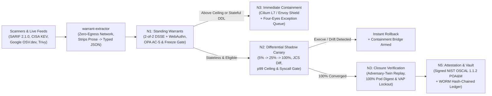

<p align="center">
  
</p>

# G1-Warrant — by G1163RT Security Labs

[](https://github.com/cgilbert61/G1-Warrant/actions/workflows/ci.yml)
[](https://github.com/cgilbert61/G1-Warrant/actions/workflows/federal-devsecops.yml)
[](LICENSE)
[-00ADD8.svg)](go.mod)
[-3776AB.svg)](sdk/python/)
[](policies/)
[](docs/govready_compliance_assessment_report.md)
[](docs/federal_devsecops_compliance_report.md)
[](reports/axe-accessibility.json)

**Deterministic Autonomous Remediation, Virtual Containment & NIST OSCAL 1.1.2 Attestation Control Plane (`v1.0`) — G1163RT Security Labs, Inc.**

---

## What Is G1-Warrant & What Problem Does It Solve?

Modern vulnerability scanners (Wiz, Trivy, Semgrep, Snyk) and threat feeds (CISA KEV, OSV) detect critical vulnerabilities in **seconds**, and automated or AI-assisted patch generators can propose candidate fixes in **minutes**. Yet across enterprise and federal environments, the median time to remediate a Known Exploited Vulnerability (`KEV`) in production remains **43 days**.

Remediation stalls in that merge-to-production gap for four structural reasons:
1. **No Pre-Negotiated Authority:** Autonomous tools and bots cannot safely push production changes because security teams and service owners have no cryptographic mechanism to pre-authorize *bounded* action ahead of an incident.
2. **Fear of Breaking Production:** Traditional automation treats stateless microservice bumps and risky database/DDL schema migrations identically—so SREs freeze *all* automated rollouts behind manual Change Advisory Boards (`CAB`).
3. **Unprotected Exposure Window:** While a stateful or complex patch waits days for human review, the vulnerable workload stays exposed on the network instead of automatically receiving a virtual eBPF/L7 containment shield within minutes.
4. **Unverified "Paper" Closures:** Tickets get marked "Resolved" when a PR merges—without replaying the exploit against an adversary twin, verifying that 100% of live pods actually run the patched digest, locking out the old image digest from ever redeploying, or minting a cryptographically signed **NIST OSCAL 1.1.2 POA&M** package for auditors.

**G1-Warrant** (`warrantd` server, `warrant` Go CLI, `pkg/warrantsdk` Go SDK, `g1-warrant-sdk` Python SDK/CLI, `warrant-extractor`, and the 5-View G1-Warrant Console) is the **deterministic safety and governance control plane** that sits between upstream scanners/patch-generators and production Kubernetes/Cilium clusters to close Known Exploited Vulnerabilities in **seconds instead of 43 days**—without ever placing an LLM inside the safety kernel.

---

## Architectural Flow & 5 Control-Plane Engines (`N1–N5`)



### Non-Negotiable Architectural Invariants

1. **100% Deterministic Safety Kernel (Zero LLM Inference in `N1–N5` or Console):** Policy evaluation (`OPA Rego`), progressive canary gating, adversary-twin verification, OSCAL attestation minting, and Console rendering are strictly deterministic state machines, cryptographic verifiers, and typed templates. External AI/LLM fix generators are treated as **untrusted upstream workers** governed outside the kernel by `N4`.
2. **The Defender Is a Delegate, Never a Principal (`N1` — `NIST SP 800-53 AC-5`):** Every automated rollout or virtual containment bridge executes solely under a pre-negotiated **Standing Warrant** carrying **`2-of-2` human cryptographic signatures** (`Slot 1: SERVICE_OWNER` + `Slot 2: AUTHORIZING_OFFICIAL`) over RFC 8785 JCS canonicalized `DSSEv1` envelopes via `Ed25519` or **W3C WebAuthn hardware authenticators** (`YubiKey` / `FIDO2 PIV`). No valid warrant (or revoked signer key) = immediate fail-closed halt.
3. **Strict Content vs. Artifact Separation (`N4` — Zero-Egress `warrant-extractor`):** Untrusted external text (`SARIF` prose, CVE descriptions, git diffs, CISA KEV bulletins, OSV advisories) never enters `warrantd` directly. It traverses a zero-privilege, network-isolated (`internal: true`, `egress: []`) **`warrant-extractor`** container that strips all free-form text and emits only regex-validated, schema-bounded typed records.
4. **Bridge-Before-Patch & Continuous Drift Lockout (`N3`):** When a vulnerability cannot be patched autonomously (e.g., contains `ALTER TABLE` DDL migrations or targets an unready service), G1-Warrant immediately deploys a **Cilium eBPF / Kubernetes NetworkPolicy / Envoy L7 containment bridge** within the SLA window while routing the change to the Four-Eyes Exception Cockpit. Once patched, G1-Warrant enforces a permanent **`ValidatingAdmissionPolicy` + Gatekeeper digest lockout** *before* retiring the bridge and watches live pods every `200ms` to re-arm containment in `< 1s` if a rogue pod ever drifts back to a banned digest.
5. **Asymmetric Emergency Freeze & WORM Hash-Chained Ledgers (`N1` & `N5`):** Any single authorized operator can trigger **`FREEZE_HOLD`** or **`FREEZE_ROLLBACK`** in one click/command (propagated via in-memory atomics + PostgreSQL `LISTEN/NOTIFY`), whereas **thawing** the fleet back to `OPERATIONAL` requires a fresh **`2-of-2` dual-key DSSE ceremony**. All warrants, governed worker actions (`TTL <= 300s`), and signed **NIST OSCAL 1.1.2 POA&M** attestations are sealed inside PostgreSQL `BEFORE UPDATE OR DELETE` trigger-protected WORM tables chained via `SHA-256`.

---

## How G1-Warrant Is Used (End-to-End Workflows by Role)

### 1. Service Owners & Authorizing Officials — Pre-Negotiating Standing Warrants (`N1`)
Instead of convening emergency meetings during an active zero-day exploit, a **Service Owner** (`Slot 1`) and a **CISO / Federal Authorizing Official** (`Slot 2`) co-sign a **Standing Warrant** defining exact autonomous rules of engagement:
- **Scoped Workloads:** e.g., `payments-ledger-api`, `identity-sso-gateway`
- **Blast-Radius Ceilings:** `max_cvss <= 10.0`, `max_blast_radius_replicas <= 8`, `allow_stateful_patches = false`, `max_p99_latency_ms <= 120ms`, `sla_bridge_minutes = 60`, hard `30-day` expiration.
- **Live Revocation:** If an Authorizing Official changes roles or loses a PIV smartcard, revoking their key in `principal_revocations` immediately invalidates every warrant they co-signed at execution time.

### 2. SecOps & CI/CD Pipelines — Ingesting Scanners & $0 Live Threat Feeds
Point existing scanners (`Trivy`, `Semgrep`, `Wiz`, `GitHub Code Scanning`) at `POST /api/v1/intake/sarif`—or enable G1-Warrant's built-in **$0 Live Public Feeds** (`CISA KEV` from `cisa.gov`, `Google OSV.dev` SBOM batch queries, and the containerized `aquasec/trivy` sidecar):
- `warrant-extractor` strips untrusted scanner prose, cross-checks CVEs against the CISA Known Exploited Vulnerabilities catalog, matches an active `N1` Standing Warrant, and launches the 5-stage **Race Remediation Pipeline**.

### 3. Platform Engineers & SREs — Differential Shadow Canary & Instant Rollback (`N2`)
Before any patch reaches 100% of production:
- **Estate Readiness Scorecard:** Grades every service against four objective gates (`>= 80%` test coverage, OpenTelemetry health probes, read-only shadow DB replica, and verified `< 60s` rollback automation).
- **Differential Shadow Inspector:** Promotes stateless patches progressively (`5% -> 25% -> 100%`), comparing baseline vs. canary **RFC 8785 JCS normalized HTTP responses** (masking volatile timestamps/UUIDs), **`p50/p95/p99` latency ceilings**, and **Linux eBPF/seccomp syscall capability sets**. If a compromised or defective patch introduces an unauthorized syscall such as `execve`, `N2` aborts and rolls back to the baseline digest in milliseconds while keeping the `N3` containment shield armed.

### 4. AI / Automated Patch Workers — Minute-Scoped Task Governance (`N4`)
External LLM or automated code-fix agents never receive cluster credentials or standing privileges. To inspect a repo or propose a candidate image digest, `warrantd` mints an Ed25519-signed **Ephemeral Task Warrant** (`TTL <= 300 seconds`) cryptographically bound to the human Standing Warrant and target service, recording `raw_input_sha256 -> typed_output_sha256` lineage in `agent_action_ledger`.

### 5. FedRAMP 3PAOs & Compliance Auditors — Zero-Trust OSCAL 1.1.2 Verification (`N5`)
Every closed vulnerability automatically mints a kernel-sealed **NIST OSCAL 1.1.2 Plan of Action & Milestones (`POA&M`)** attestation containing the human warrant chain, adversary-twin exploit replay hash, 100% pod digest manifest, and permanent admission lockout ID:
- Operators mint time-bounded, read-only **`g1aud_*` bearer links** (`/auditor?token=g1aud_...`) for external auditors. Any attempt to use an auditor token against operational endpoints returns **`HTTP 403 AUDITOR_TOKEN_SCOPE_VIOLATION`**.
- Auditors verify `RFC 8785 JCS` canonicalization and `Ed25519` signatures **client-side in the browser** or **100% offline** via `warrant oscal verify-offline` / `g1-warrant oscal-verify`.

---

## Quick Start (Zero Host Toolchains Required)

```bash
# 1. Start PostgreSQL 16 WORM store, zero-egress warrant-extractor, fleet-sim, and warrantd
docker compose up --build -d

# 2. Open the embedded 5-View G1-Warrant Console (W3C WebAuthn localhost enabled)
#    -> http://localhost:8080

# 3. Check live control-plane posture from the embedded CLI
docker compose exec warrantd /warrant status
```

### Optional $0 Live Threat & Scanner Feeds (`offline` Enclave Default vs. `live`)

By default, `WARRANT_FEED_MODE=offline` keeps G1-Warrant 100% air-gapped for federal enclaves and deterministic CI runs. To pull **live US Government CISA KEV bulletins (`cisa.gov`)**, **Google OSV.dev SBOM advisories (`api.osv.dev`)**, and **live `aquasec/trivy` container `SARIF 2.1.0` scans** (all sanitized through `warrant-extractor`):

```bash
# PowerShell:
$env:WARRANT_FEED_MODE="live"; $env:WARRANT_TRIVY_ENABLED="true"; docker compose --profile live-feeds up --build -d

# Linux / macOS:
WARRANT_FEED_MODE=live WARRANT_TRIVY_ENABLED=true docker compose --profile live-feeds up --build -d
```

---

## Official SDKs & Command-Line Interfaces (`Go` & `Python`)

G1-Warrant provides both a **Pure-Go Client SDK (`pkg/warrantsdk`) + `warrant` CLI** and a **Standalone Python Client SDK (`sdk/python` / `g1-warrant-sdk`) + `g1-warrant` CLI**. Full documentation is available in [`docs/sdk_and_cli_guide.md`](docs/sdk_and_cli_guide.md).

### 1. Native `warrant` CLI (`cmd/warrant`)

```bash
# Build locally (or run via `docker compose exec warrantd /warrant ...`)
go build -o warrant ./cmd/warrant

# Inspect live fleet scoreboard, warrants, race pipeline & estate readiness
./warrant status
./warrant warrants list
./warrant pipeline list
./warrant estate

# Multi-party offline 2-of-2 AC-5 Standing Warrant ceremony
./warrant warrants draft --class KEV-TIER1-STATELESS --services payments-ledger-api --out warrant.dsse.json
./warrant warrants sign --in warrant.dsse.json --slot 1 --demo-persona usr-alice-so
./warrant warrants sign --in warrant.dsse.json --slot 2 --demo-persona usr-bob-ao
./warrant warrants submit warrant.dsse.json

# Run deterministic control-plane drills (KEV closure, execve rollback, DDL gate, pod drift)
./warrant simulate inject-kev
./warrant simulate bad-syscall
./warrant simulate stateful-ddl
./warrant simulate runtime-drift

# Verify all 3 PostgreSQL WORM hash chains & verify an exported NIST OSCAL 1.1.2 POA&M offline
./warrant ledger verify
./warrant oscal export <attestation-id> poam-bundle.json
./warrant oscal verify-offline poam-bundle.json
```

### 2. Python Client SDK & CLI (`sdk/python` — `g1-warrant-sdk`)

```bash
# Install the standalone Python SDK & `g1-warrant` CLI
pip install -e sdk/python

# Verify CLI against live warrantd
g1-warrant status
g1-warrant ledger-verify
```

```python
from g1_warrant import (
    WarrantClient,
    draft_warrant_envelope,
    verify_oscal_bundle_offline,
)

client = WarrantClient("http://localhost:8080")

# 1. Mint a 2-of-2 Standing Warrant (Slot 1 Service Owner + Slot 2 Authorizing Official)
env = draft_warrant_envelope(scope_services=["payments-ledger-api"], max_cvss=10.0)
client.builtin_demo_signer("usr-alice-so").sign_envelope(1, env)
client.builtin_demo_signer("usr-bob-ao").sign_envelope(2, env)
warrant = client.create_warrant(env)

# 2. Ingest a scanner SARIF 2.1.0 report into the Race Remediation Pipeline
items = client.ingest_sarif("./reports/trivy-fs.sarif", target_service="payments-ledger-api")

# 3. Export a closed NIST OSCAL 1.1.2 POA&M bundle & verify DSSE + RFC 8785 JCS offline
atts = client.list_attestations()
if atts:
    bundle = client.export_oscal_bundle(atts[0]["attestation_id"])
    proof = verify_oscal_bundle_offline(bundle, client.kernel_public_key_b64())
    print("Offline OSCAL DSSE Verified:", proof["valid"], "PAE SHA-256:", proof["pae_sha256"])
```

### 3. Go Client SDK (`pkg/warrantsdk`)

```go
import "github.com/g1163rt-labs/g1-warrant/pkg/warrantsdk"

cli := warrantsdk.NewClient("http://localhost:8080")
sb, err := cli.Scoreboard(ctx)
rep, err := cli.VerifyLedgerChains(ctx)
```

---

## 5-View Embedded Operator Console (`http://localhost:8080`)

| Console View | Operational Surface |
| :--- | :--- |
| **Global Command Bar** | Live fleet KPIs, `/warrant` deterministic command bar, `Feeds: OFFLINE \| LIVE` modal, 1-click Asymmetric Emergency Freeze (`FREEZE_HOLD` / `FREEZE_ROLLBACK`), and `2-of-2` Thaw ceremony. |
| **View 1 — Race Pipeline** | 5-stage autonomous Kanban (`INTAKE_REPRO -> BRIDGED_CONTAINED -> SHADOW_CANARY -> VERIFYING_LOCKING -> ATTESTED_CLOSED`), live SLA timers, 4 interactive drill triggers, and millisecond Execution Trace Drawer. |
| **View 2 — Warrant Desk** | `N1` Approval Pressure Analytics, Four-Eyes Ceiling Exception Cockpit, `2-of-2` Standing Warrant DSSE Composer, W3C WebAuthn hardware key enrollment, and live signer key revocation. |
| **View 3 — Shadow & Estate** | Split-pane Differential Shadow Inspector (`RFC 8785 JCS` schema diff, `p50/p95/p99` latency bars, Linux syscall capability diff) and `N2` Estate Autonomous Eligibility Scorecard. |
| **View 4 — Containment & Drift** | Active Cilium L7 / Envoy / K8s NetworkPolicy bridges, YAML/Rego policy inspector, permanent `ValidatingAdmissionPolicy` digest lockouts, and `200ms` runtime drift monitor. |
| **View 5 — OSCAL Vault & Ledger** | DSSE-signed NIST OSCAL `1.1.2` POA&M Vault with in-browser cryptographic verification, Scoped 3PAO `/auditor` bearer link generator, and 3-table SHA-256 WORM hash-chain verifier. |

---

## Repository Layout

- `cmd/warrantd/` — Control-plane server embedding SQL migrations, OPA Rego policies, and React 19 Console
- `cmd/warrant/` — Full-featured Pure-Go Operator, Ceremony & Offline Auditor CLI
- `cmd/warrant-extractor/` — Zero-privilege, egress-denied untrusted `SARIF` / `KEV` / `OSV` / `Diff` sanitizer
- `cmd/fleet-sim/` — Containerized Kubernetes Deployment, Cilium NetworkPolicy & Adversary-Twin simulator
- `pkg/warrantsdk/` — Official exported Go Client SDK & offline DSSE / NIST OSCAL `1.1.2` verification library
- `sdk/python/` — Official standalone Python Client SDK (`g1-warrant-sdk`), offline verifier & `g1-warrant` CLI
- `internal/` — Five deterministic engines (`warrant`, `gate`, `verify`, `agentcp`, `ledger`), `crypto` (`jcs`, `dsse`, `webauthn`), `policy`, `feeds`, `adapters`, `db`, `server`, and `-race` E2E invariant suite (`internal/e2e`)
- `policies/` — Embedded OPA Rego v1 policies & unit tests (`warrant_ac5.rego`, `gate_eligibility.rego`, `verify_closure.rego`)
- `db/migrations/` — PostgreSQL 16 schema, `BEFORE UPDATE OR DELETE` WORM triggers, and `LISTEN/NOTIFY` freeze channel
- `web/` — Embedded React 19 + TypeScript 5 + Tailwind Console (`Section 508` / `WCAG 2.1 Level AA` verified)
- `k8s/` — DISA STIG / Checkov-hardened Kubernetes manifests (`Namespace`, `Deployments`, `Services`, zero-egress `NetworkPolicies`)
- `scripts/` & `benchmarks/` — 9-Gate Federal DevSecOps Harness (`compliance_harness.py`), GovReady-Q runner, Section 508 auditor, and `k6` SLA benchmark
- `docs/` & `reports/` — System Security Plan (`SSP`), NIST OSCAL Component Definition, OpenAPI 3.1 spec, ADRs, and machine-readable SARIF/CycloneDX/OSCAL audit deliverables

---

## 9-Gate Federal DevSecOps & NIST SP 800-53 Compliance Scorecard

G1-Warrant (`FISMA ID: G1-WARRANT-001`) is continuously verified against a **9-Gate Federal DevSecOps Pipeline** (`make compliance-check`):

| Gate | Toolchain | Governing Standard | Verdict | Empirical Result | Deliverable |
| :--- | :--- | :--- | :--- | :--- | :--- |
| **1. SAST & Code Quality** | Semgrep + SonarQube | NIST SP 800-53 SA-11 / OWASP Top 10 | **PASS** | `0` CWE / Zero-LLM Findings | [`reports/semgrep.sarif`](reports/semgrep.sarif) |
| **2. Secrets Detection** | Gitleaks | NIST SP 800-53 IA-5 / DISA STIG | **PASS** | `0` Secrets in Git History | [`reports/gitleaks.sarif`](reports/gitleaks.sarif) |
| **3. IaC Security Scanning** | Checkov | NIST SP 800-53 CM-2 / DISA STIG K8s & Docker | **PASS** | `0` Critical/High Misconfigs | [`reports/checkov.sarif`](reports/checkov.sarif) |
| **4. SBOM Generation** | Syft (`CycloneDX 1.5`) | Executive Order 14028 / NIST SP 800-161 | **PASS** | `48` Cataloged Components | [`reports/sbom.cdx.json`](reports/sbom.cdx.json) |
| **5. SCA & Containers** | Trivy | DISA STIG / NIST SP 800-53 SI-2 & RA-5 | **PASS** | `0` Critical/High CVEs | [`reports/trivy-fs.sarif`](reports/trivy-fs.sarif) |
| **6. DAST Dynamic Scan** | OWASP ZAP Baseline | NIST SP 800-53 RA-5 / OWASP Top 10 | **PASS** | `0` Active Injection Alerts | [`reports/zap_warrantd_report.json`](reports/zap_warrantd_report.json) |
| **7. Section 508 A11y** | `axe-core` / WCAG 2.1 AA | Section 508 / WCAG 2.1 Level AA | **PASS** | `79 / 79` Passed (`0` Violations) | [`reports/axe-accessibility.json`](reports/axe-accessibility.json) |
| **8. Load & SLA Testing** | `k6` | Control-Plane API SLA (`p95 <= 35.0ms`) | **PASS** | `5.87 ms` `p95` (`0%` Errors) | [`reports/k6-summary.json`](reports/k6-summary.json) |
| **9. Federal GRC Platform** | GovReady-Q (`v0.9.1`) | NIST SP 800-53 Rev 4 (`14` Controls) | **PASS** | `14 / 14` Implemented (`OSCAL`) | [`docs/g1_warrant_oscal_component.json`](docs/g1_warrant_oscal_component.json) |

```bash
# Run all 9 Federal DevSecOps compliance gates locally
make compliance-check

# Run embedded OPA Rego policy tests + Go -race invariant & live-feed E2E suite
make docker-test
```

---

## License

Copyright © 2026 **G1163RT Security Labs, Inc.** Licensed under the [Apache License, Version 2.0](LICENSE).
