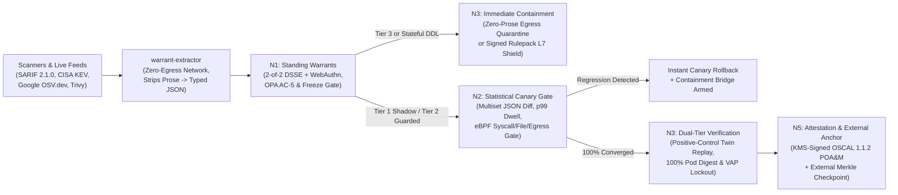

<p align="center">
  
</p>

# G1-Warrant — by G1163RT Security Labs

[](https://github.com/cgilbert61/G1-Warrant/actions/workflows/ci.yml)
[](https://github.com/cgilbert61/G1-Warrant/actions/workflows/federal-devsecops.yml)
[](LICENSE)
[-brightgreen.svg)](THIRD_PARTY_LICENSES.md)
[-00ADD8.svg)](go.mod)
[-3776AB.svg)](sdk/python/)
[](policies/)
[](docs/govready_compliance_assessment_report.md)
[](docs/federal_devsecops_compliance_report.md)
[](reports/axe-accessibility.json)

**Deterministic Autonomous Remediation, Virtual Containment & NIST OSCAL 1.1.2 Attestation Control Plane (`v1.0`) — G1163RT Security Labs, Inc.**

> **Core Operational Principle:** **Contain in seconds; verify and roll out safely in minutes.**

---

## What Is G1-Warrant & What Problem Does It Solve?

Modern vulnerability scanners (`Wiz`, `Trivy`, `Semgrep`, `Snyk`) and threat feeds (`CISA KEV`, `Google OSV.dev`) detect critical vulnerabilities in **seconds**, and upstream build pipelines or automated fix generators can produce signed candidate patches in **minutes**. Yet across enterprise and federal production estates, the median time to remediate a Known Exploited Vulnerability (`KEV`) remains **43 days**.

Remediation stalls in that merge-to-production gap for four structural reasons:

1. **No Pre-Negotiated Authority:** Autonomous tools cannot safely push production changes because security teams and service owners lack a cryptographic contract to pre-authorize *bounded* action ahead of an incident.
2. **All-or-Nothing Rollout Cliffs:** Traditional automation either pushes patches blindly without statistical canary dwell/sampling or blocks brownfield workloads behind manual Change Advisory Boards (`CAB`).
3. **Blind Virtual Patching vs. Unprotected Exposure:** Guessing application HTTP routes from stripped CVE prose causes self-inflicted L7 outages, while doing nothing leaves unpatched pods exposed to reverse shells and callback exploitation during review.
4. **Unverified "Paper" Closures & Broken PoC Traps:** Closing tickets when a PR merges—or when an unverified exploit script fails against an unpatched target—creates false assurance without proving live pod SHA-256 digest convergence, enforcing cluster admission lockouts, or sealing **NIST OSCAL 1.1.2 POA&M** evidence for 3PAO auditors.

**G1-Warrant** (`warrantd` server, `warrant` Go CLI, `pkg/warrantsdk` Go SDK, `g1-warrant-sdk` Python SDK/CLI, `warrant-extractor`, and the 5-View G1-Warrant Console) is the **deterministic safety and governance control plane** that sits between upstream scanners/patch-providers and production Kubernetes/Cilium clusters—**containing active exposure in seconds and verifying autonomous rollouts safely in minutes**, with **zero LLM inference inside the safety kernel**.

---

## Architectural Flow & 5 Control-Plane Engines (`N1–N5`)



### Non-Negotiable Architectural & Production SRE Invariants

1. **100% Deterministic Safety Kernel (`Zero LLM Inference` in `N1–N5` or Console):** Policy evaluation (`OPA Rego v1`), statistical canary gating, differential twin verification, OSCAL attestation minting, and Console rendering are strictly deterministic state machines and cryptographic verifiers. External AI/LLM fix generators operate solely outside the kernel as untrusted workers governed by `N4`.
2. **Dual-Key Standing Warrants & Zero Demo Signers (`N1` — `NIST SP 800-53 Rev 5 AC-5`):** Every automated rollout or containment action executes under a **Standing Warrant** carrying **`2-of-2` human cryptographic signatures** (`Slot 1: SERVICE_OWNER` + `Slot 2: AUTHORIZING_OFFICIAL`) over `RFC 8785 JCS` canonicalized `DSSEv1` envelopes via `Ed25519` or **W3C WebAuthn hardware authenticators** (`FIDO2` / `PIV`). Production SDKs and CLIs ship **zero hardcoded demo signers**, and `warrantd` redacts sandbox personas by default (`WARRANT_ENABLE_TEST_SMARTCARDS=false`).
3. **Zero-Prose Quarantine vs. Publisher-Signed L7 Rulepacks (`N3` & `N4` — `SC-7(5)`):**
   - `warrant-extractor` strips untrusted `SARIF`/`KEV`/`OSV` prose inside a zero-egress container. Because stripped telemetry lacks custom application route semantics, `N3` **never guesses HTTP routes**.
   - By default, `N3` enforces **`ZERO_PROSE_EGRESS_MESH_QUARANTINE`**—cutting external world egress (`toEntities: ["world"]`) to block reverse shells, JNDI callbacks, and C2 beacons while preserving authenticated internal mTLS mesh traffic without causing blind L7 outages.
   - Targeted Envoy/Cilium HTTP path/header virtual patches (**`SIGNED_RULEPACK_L7_SHIELD`**) are applied *only* when an Ed25519 publisher-signed CWE/CVE `SignedVirtualPatchRulepack` matches in `RulepackRegistry`.
4. **3-Tier Graduated Fleet Autonomy & Resilient Canary Diffing (`N2` — `CM-2`, `CM-3(4)`):**
   - Replaces rigid binary coverage cliffs with **three graduated tiers**: **`TIER_1_FULL_AUTONOMOUS`** (`>= 80%` coverage + OTel probes + ephemeral CoW/shadow DB + verified rollback), **`TIER_2_GUARDED_CANARY`** (brownfield services with OTel SLI probes + `< 10s` rollback hooks when authorized by `allow_guarded_canary`), and **`TIER_3_CONTAIN_AND_CAB`** (automatic L3/L4 egress quarantine + Four-Eyes CAB).
   - Enforces configurable `min_canary_samples` and `stage_dwell_seconds` on Standing Warrants, blocks mutating traffic from hitting read-only replicas, compares HTTP JSON payloads using **order-insensitive multiset array canonicalization**, `1e-6` floating-point epsilon tolerance, and custom `volatile_json_paths` masks (reserving strict byte-for-byte `RFC 8785 JCS` for `DSSE` cryptographic signatures), and monitors **in-process file reads** (e.g., `serviceaccount/token`) and **unexpected egress** alongside `execve` syscalls.
5. **Differential Twin Positive Control & Dual Assurance Tiers (`N3` & `N5` — `RA-5`):**
   - Prevents broken exploit scripts from producing false-negative closures: **`ASSURANCE_TIER_2_DIFFERENTIAL_TWIN`** requires positive-control confirmation that the signed probe **succeeds** against `vulnerable_digest` (`unpatched_twin_status == "EXPLOIT_SUCCEEDED"`) AND **is blocked** against `patched_digest` (`twin_replay_status == "EXPLOIT_BLOCKED"`).
   - For standard `Trivy`/`OSV`/`KEV` advisories without weaponized PoCs, `warrantd` closes honestly at **`ASSURANCE_TIER_1_PASSIVE_DIGEST_SBOM`** (requiring Ed25519 publisher provenance, 100% live pod `imageID` SHA-256 digest convergence, unloaded vulnerable symbols, and enforced cluster admission lockout) and records the exact assurance tier inside the minted **NIST OSCAL 1.1.2 POA&M**.
6. **Atomic 3-Step `QUARANTINED_ROLLBACK` (`Contain-Before-Unban`) & Streaming K8s `WATCH` (`N3` — `CA-7`):**
   - Resolves the post-closure latent regression vs. `ValidatingAdmissionPolicy` lockout collision via `POST /api/v1/pipeline/{id}/emergency-rollback`: **(1)** re-arms the `N3` containment bridge *first*, **(2)** suspends the `ValidatingAdmissionPolicy` (`SUSPENDED_FOR_QUARANTINED_ROLLBACK`), and **(3)** rolls pods back to the previous digest under active quarantine.
   - `LiveKubernetesAdapter` (`WARRANT_CLUSTER_DRIVER=kubernetes`) uses chunked **`kube-apiserver` `WATCH` streams** (`?watch=true&allowWatchBookmarks=true&resourceVersion=...`) instead of high-frequency `LIST` polling.
7. **Non-Exportable KMS Signing & External Merkle Transparency Anchor (`N5` — `AU-9(3)`, `SR-11`):**
   - Abstracts attestation and task signing behind `crypto.EnvelopeSigner` (`RemoteKMSSigner` via `WARRANT_KMS_SIGN_URL` for Vault Transit / Cloud KMS / HSM, or ephemeral in-memory keys).
   - Pairs PostgreSQL `BEFORE UPDATE OR DELETE` immutability triggers with **`TransparencyAnchor`**, shipping DSSE-signed binary Merkle Root checkpoints outside PostgreSQL (`WARRANT_EXTERNAL_ANCHOR_PATH` / `WARRANT_EXTERNAL_ANCHOR_URL`) so even a rogue DB superuser who disables triggers and rewrites rows is caught during `VerifyAllLedgerChains`.

---

## Quick Start (Zero Host Toolchains Required)

```bash
# 1. Start PostgreSQL 16 ledger store, zero-egress warrant-extractor, fleet-sim, and warrantd
docker compose up --build -d

# 2. Open the embedded 5-View G1-Warrant Console (W3C WebAuthn localhost enabled)
#    -> http://localhost:8080

# 3. Inspect live control-plane posture via the embedded Go CLI
docker compose exec warrantd /warrant status
```

### Optional \$0 Live Threat & Scanner Feeds (`offline` Enclave Default vs. `live`)

By default, `WARRANT_FEED_MODE=offline` keeps G1-Warrant 100% air-gapped for federal enclaves and deterministic CI runs. To pull **live US Government CISA KEV bulletins (`cisa.gov`)**, **Google OSV.dev SBOM advisories (`api.osv.dev`)**, and **live `aquasec/trivy` container `SARIF 2.1.0` scans** (all sanitized through `warrant-extractor`):

```powershell
# Windows PowerShell
$env:WARRANT_FEED_MODE="live"; $env:WARRANT_TRIVY_ENABLED="true"; docker compose --profile live-feeds up --build -d
```

```bash
# Linux / macOS
WARRANT_FEED_MODE=live WARRANT_TRIVY_ENABLED=true docker compose --profile live-feeds up --build -d
```

---

## Official SDKs & Command-Line Interfaces (`Go` & `Python`)

G1-Warrant provides both a **Pure-Go Client SDK (`pkg/warrantsdk`) + `warrant` CLI** and a **Standalone Python Client SDK (`sdk/python` / `g1-warrant-sdk`) + `g1-warrant` CLI**. Full API and ceremony documentation is available in [`docs/sdk_and_cli_guide.md`](docs/sdk_and_cli_guide.md).

### 1. Native `warrant` CLI (`cmd/warrant`)

```bash
# Build locally (or invoke via `docker compose exec warrantd /warrant ...`)
go build -o warrant ./cmd/warrant

# Inspect live fleet scoreboard, warrants, race pipeline & graduated autonomy tiers
./warrant status
./warrant warrants list
./warrant pipeline list
./warrant estate

# Generate explicit AC-5 Ed25519 key bundles (Slot 1 Service Owner + Slot 2 Authorizing Official)
./warrant keygen --id usr-so-01 --email so@agency.gov --role SERVICE_OWNER --out so-key.json
./warrant keygen --id usr-ao-01 --email ao@agency.gov --role AUTHORIZING_OFFICIAL --out ao-key.json

# Draft, 2-of-2 co-sign, and submit an RFC 8785 JCS Standing Warrant DSSE envelope
./warrant warrants draft --class KEV-TIER1-STATELESS --services payments-ledger-api --out warrant.dsse.json
./warrant warrants sign --in warrant.dsse.json --slot 1 --key so-key.json
./warrant warrants sign --in warrant.dsse.json --slot 2 --key ao-key.json
./warrant warrants submit warrant.dsse.json

# Execute atomic 3-step Quarantined Rollback (Contain-Before-Unban) if a post-closure regression occurs
./warrant pipeline rollback <remediation-id> --actor sre-oncall --reason LATENT_POOL_LEAK

# Verify all 3 ledger hash chains + External Merkle Checkpoints & verify OSCAL 1.1.2 POA&M offline
./warrant ledger verify
./warrant ledger checkpoints
./warrant oscal export <attestation-id> poam-bundle.json
./warrant oscal verify-offline poam-bundle.json
```

### 2. Python Client SDK & CLI (`sdk/python` — `g1-warrant-sdk`)

```bash
pip install -e sdk/python
g1-warrant status
g1-warrant ledger-verify
```

```python
from g1_warrant import (
    ROLE_AUTHORIZING_OFFICIAL,
    ROLE_SERVICE_OWNER,
    WarrantClient,
    draft_warrant_envelope,
    generate_ed25519_signer_bundle,
    verify_oscal_bundle_offline,
)

client = WarrantClient("http://localhost:8080")

# 1. Draft and 2-of-2 co-sign a Standing Warrant using explicit Ed25519 keys
so = generate_ed25519_signer_bundle("usr-so-01", "so@agency.gov", "Service Owner", ROLE_SERVICE_OWNER)
ao = generate_ed25519_signer_bundle("usr-ao-01", "ao@agency.gov", "Authorizing Official", ROLE_AUTHORIZING_OFFICIAL)
env = draft_warrant_envelope(scope_services=["payments-ledger-api"], max_cvss=10.0)
so.sign_envelope(1, env)
ao.sign_envelope(2, env)

# 2. Export a closed NIST OSCAL 1.1.2 POA&M bundle & verify DSSE + RFC 8785 JCS offline
atts = client.list_attestations()
if atts:
    bundle = client.export_oscal_bundle(atts[0]["attestation_id"])
    proof = verify_oscal_bundle_offline(bundle, client.kernel_public_key_b64())
    print("Offline OSCAL DSSE Verified:", proof["valid"], "PAE SHA-256:", proof["pae_sha256"])
```

### 3. Go Client SDK (`pkg/warrantsdk`)

```go
import "github.com/g1163rt-labs/g1-warrant/pkg/warrantsdk"

cli := warrantsdk.NewClient("http://localhost:8080")
sb, err := cli.Scoreboard(ctx)
rep, err := cli.VerifyLedgerChains(ctx)
```

---

## 5-View Embedded Operator Console (`http://localhost:8080`)

| Console View | Operational Surface |
| :--- | :--- |
| **Global Command Bar** | Live fleet KPIs, `/warrant` deterministic command bar, `Feeds: OFFLINE / LIVE` modal, 1-click Asymmetric Emergency Freeze (`FREEZE_HOLD` / `FREEZE_ROLLBACK`), and `2-of-2` Thaw ceremony. |
| **View 1 — Race Pipeline** | 5-stage autonomous Kanban (`INTAKE_REPRO -> BRIDGED_CONTAINED -> SHADOW_CANARY -> VERIFYING_LOCKING -> ATTESTED_CLOSED`), live SLA timers, 4 interactive drill triggers, and millisecond Execution Trace Drawer. |
| **View 2 — Warrant Desk** | `N1` Approval Pressure Analytics, Four-Eyes Ceiling Exception Cockpit, `2-of-2` Standing Warrant DSSE Composer, W3C WebAuthn hardware key enrollment, and live signer key revocation. |
| **View 3 — Shadow & Estate** | Split-pane Differential Shadow Inspector (order-insensitive multiset JSON schema diff, `p50/p95/p99` latency bars, eBPF syscall/file/egress diff) and 3-Tier Graduated Autonomy Scorecard. |
| **View 4 — Containment & Drift** | Active `ZERO_PROSE_EGRESS_MESH_QUARANTINE` & `SIGNED_RULEPACK_L7_SHIELD` bridges, YAML/Rego inspector, `ValidatingAdmissionPolicy` digest lockouts, and streaming runtime drift monitor. |
| **View 5 — OSCAL Vault & Ledger** | Dual-tier DSSE-signed NIST OSCAL `1.1.2` POA&M Vault with in-browser verification, Scoped 3PAO `/auditor` bearer link generator, and 3-table SHA-256 + External Merkle Checkpoint verifier. |

---

## 9-Gate Federal DevSecOps & NIST SP 800-53 Rev 5 Scorecard

G1-Warrant (`FISMA ID: G1-WARRANT-001`) is continuously verified against a **9-Gate Federal DevSecOps Pipeline** (`make compliance-check`) and an automated **SPDX Open-Source License Audit** (`make license-check`):

| Gate | Toolchain | Governing Standard | Verdict | Empirical Result | Deliverable |
| :--- | :--- | :--- | :--- | :--- | :--- |
| **1. SAST & Code Quality** | Semgrep + SonarQube | NIST SP 800-53 Rev 5 SA-11 / OWASP Top 10 | **PASS** | `0` CWE / Zero-LLM Findings | [`reports/semgrep.sarif`](reports/semgrep.sarif) |
| **2. Secrets Detection** | Gitleaks | NIST SP 800-53 Rev 5 IA-5 / DISA STIG | **PASS** | `0` Secrets in Git History | [`reports/gitleaks.sarif`](reports/gitleaks.sarif) |
| **3. IaC Security Scanning** | Checkov | NIST SP 800-53 Rev 5 CM-2 / DISA STIG K8s | **PASS** | `0` Critical/High Misconfigs | [`reports/checkov.sarif`](reports/checkov.sarif) |
| **4. SBOM & SPDX Licenses** | Syft (`CycloneDX 1.5`) + SPDX | EO 14028 / NIST SP 800-53 Rev 5 SR-3 | **PASS** | `48/48` SPDX Permissive (`0` Copyleft) | [`reports/sbom.cdx.json`](reports/sbom.cdx.json) |
| **5. SCA & Containers** | Trivy | DISA STIG / NIST SP 800-53 Rev 5 SI-2 & RA-5 | **PASS** | `0` Critical/High CVEs | [`reports/trivy-fs.sarif`](reports/trivy-fs.sarif) |
| **6. DAST Dynamic Scan** | OWASP ZAP Baseline | NIST SP 800-53 Rev 5 RA-5 / OWASP Top 10 | **PASS** | `0` Active Injection Alerts | [`reports/zap_warrantd_report.json`](reports/zap_warrantd_report.json) |
| **7. Section 508 A11y** | `axe-core` / WCAG 2.1 AA | Section 508 / WCAG 2.1 Level AA | **PASS** | `79 / 79` Passed (`0` Violations) | [`reports/axe-accessibility.json`](reports/axe-accessibility.json) |
| **8. Load & SLA Testing** | `k6` | Control-Plane API SLA (`p95 <= 35.0ms`) | **PASS** | `< 10 ms` `p95` (`0%` Errors) | [`reports/k6-summary.json`](reports/k6-summary.json) |
| **9. Federal GRC Platform** | GovReady-Q (Rev 5) | NIST SP 800-53 Rev 5 (`16` Controls) | **PASS** | `16 / 16` Implemented (`OSCAL 1.1.2`) | [`docs/g1_warrant_oscal_component.json`](docs/g1_warrant_oscal_component.json) |

```bash
# Audit all open-source licenses & verify CycloneDX SPDX attribution
make license-check

# Run all 9 Federal DevSecOps compliance gates locally
make compliance-check

# Run embedded OPA Rego policy tests + Go -race 7-invariant & live-feed E2E suite
make docker-test
```

---

## Open-Source Licensing

Copyright © 2026 **G1163RT Security Labs, Inc.** Licensed under the [Apache License, Version 2.0](LICENSE).  
Complete third-party SPDX attributions and license notices are documented in [`NOTICE`](NOTICE) and [`THIRD_PARTY_LICENSES.md`](THIRD_PARTY_LICENSES.md).
