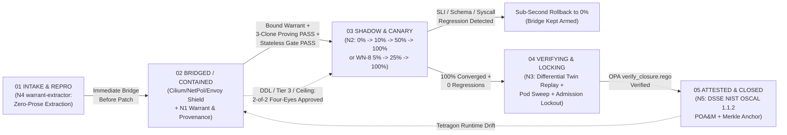

# G1-Warrant 5-Stage Autonomous Race Pipeline Walkthrough (`01` → `05`)

This guide walks step-by-step through how every vulnerability or secret-exposure finding enters **G1-Warrant**, what deterministic engine (`N1`–`N5`) executes inside each of the 5 Race Pipeline columns, what cryptographic/OPA gate promotes a card to the next column, and how operators advance items that pause fail-closed at a gate.

---

## End-to-End Pipeline Gate Map



---

## Stage `01` — `INTAKE & REPRO` (`StageIntakeRepro` · Engine `N4`)

> **Why the column badge normally reads `0`:** Items pass through Stage `01` in milliseconds on their way to immediate containment in Stage `02`.

### What Runs Automatically
1. **Token-Only Arrival (Zero Human Dual-Key Required at Ingest):**
   - Findings arrive on `POST /api/v1/intake/{qualys,tenable,rapid7,sarif,secrets}` (or via `warrant intake ... --intake-token` / the Console **Ingest Scanner Export** panel) authenticated strictly with `X-Warrant-Intake-Token` (`WARRANT_INTAKE_TOKEN`).
   - Dual-key (`Slot 1: SERVICE_OWNER` + `Slot 2: AUTHORIZING_OFFICIAL`) is **never** requested at ingest.
2. **Zero-Egress Sanitization (`warrant-extractor`):**
   - `warrantd` mints a short-lived `N4` Ephemeral Task Warrant (`X-Warrant-Task-DSSE` + `X-Warrant-Agent-PoP`) and forwards the raw report into the isolated, zero-egress `warrant-extractor` container.
   - `warrant-extractor` disables XML external entities (`XXE`), strips 100% of scanner prose, HTML, markdown, and prompt-injection strings, and returns a strictly typed `ExtractedFindingSet` (`CVE-*` or `UNMAPPED-*`, `CWE-*`, `CVSS`, target service/asset aliases, and SHA-256 input/output digests).
3. **Live CISA KEV Cross-Check & Persistence:**
   - Cross-references incoming CVEs against the synced CISA KEV catalog and writes the initial `rem-*` remediation item and `N4` trace event (`SARIF_EXTRACTED_TYPED_SCHEMA` / `FINDER_REPORT_EXTRACTED`).

### Gate to Advance (`01 → 02`)
- **Automatic & Unconditional:** Every valid finding immediately triggers **Bridge Before Patch** to enter Stage `02`.

---

## Stage `02` — `BRIDGED / CONTAINED` (`StageBridgedContained` · Shield + `N1` + `N3` Proving)

> **Why items accumulate here:** Every finding gets an immediate containment shield in seconds. Items without pre-negotiated autonomous authority—or patches requiring human Four-Eyes review—wait safely behind active containment here until authorized.

### What Runs Automatically
1. **Immediate Multi-Substrate Containment Shield (`MultiSubstrateShieldRouter`):**
   - Deterministically routes Stage `02` containment across all **6 substrates** based on asset identity and distributor target, blocking cloud metadata (`169.254.169.254`, `168.63.129.16`, `fd00:ec2::254`), external C2/reverse-shell egress, and optional untrusted exploit ports in sub-second time:
     - **`KUBERNETES`:** `CiliumNetworkPolicy`, Kubernetes `NetworkPolicy`, and Envoy SPIFFE mTLS (`CILIUM_L7_NETPOL` / `ENVOY_MTLS_WAF` / `K8S_NETPOL`).
     - **`AWS_EC2` (`AWS_EC2_SG_IMDS`):** Snapshots original SecurityGroupIds, attaches Quarantine SG (`ModifyInstanceAttribute`), and clamps `IMDSv2` (`ModifyInstanceMetadataOptions` `HttpTokens=required`, `HopLimit=1`) via AWS SigV4; symmetrically restores original SGs at Stage `04`.
     - **`AZURE_VM` (`AZURE_NSG_QUARANTINE`):** Applies ARM `Microsoft.Network/networkSecurityGroups/securityRules` Priority-100 outbound/metadata deny rule (`DELETE` at Stage `04`).
     - **`GCP_GCE` (`GCP_VPC_FIREWALL`):** Inserts Compute Engine v1 `compute#firewall` Priority-100 deny rule (`DELETE` at Stage `04`).
     - **`LINUX_HOST` (`LINUX_NFTABLES_SHIELD`):** Compiles an isolated atomic `nft -f` table (`table inet g1_warrant_<id>`) retired via `nft delete table inet g1_warrant_<id>` without touching existing host firewall tables.
     - **`WINDOWS_HOST` (`WINDOWS_WFP_NETFIREWALL`):** Compiles a grouped Windows Filtering Platform rule set (`New-NetFirewallRule -Group 'G1-Warrant-Bridge-<id>'`) retired via `Remove-NetFirewallRule -Group`.
2. **`N1` Standing Warrant Lookup (`internal/server/orchestrator.go`):**
   - Checks for an active, unrevoked `2-of-2` DSSE Standing Warrant covering `(service_id, cvss_score <= max_cvss, cwe_id)` (or `AuthorizedVendorDetections` for unmapped scanner QIDs/Plugins).
   - If none matches, the item stays **passively contained** (`StatusHealth = "BRIDGED"`, `ClassBindingStatus = "UNBOUND"`, **`0`** Four-Eyes exception rows created).
3. **Artifact Publisher Provenance & Unified Diff Guard (`N4`):**
   - Verifies the Ed25519 publisher provenance signature on the candidate fix (`ARTIFACT_PROVENANCE_VERIFIED`).
   - Parses the unified diff inside `warrant-extractor`, failing closed (`N4_FORBIDDEN_CONFIG_POISONING_BLOCKED`) if a patch attempts to tamper with `.github/workflows`, `Dockerfile`, OPA `.rego` policies, or agent configs.
4. **3-Clone Isolated Proving Ground (`internal/verify/clone_twin.go`):**
   - **Runtime-Follows-Patch:** Routes `USERSPACE_SOFTWARE` patches to `CONTAINER_TWIN` (`3` isolated pods in zero-egress `g1-twin-proving`) and `KERNEL` / `BOOT_LAYER` patches to `VM_TWIN` (`aws-ec2`, `azure-vm`, `gcp-gce`, or `hyperv`, failing closed with `KERNEL_PATCH_REQUIRES_VM_TWIN_RUNTIME` if unset).
   - **Estate Drift Re-Read (`v1.4.0`):** Re-queries the Estate Loader source bound in the Standing Warrant (`SIGNED_CLASS` → `SIGNED_CLASS_MANUAL` → `ENV_BOOTSTRAP_FALLBACK`), records `ProvingSnapshotSHA256`, and enforces `estate_drift_policy` (`RECORD_ONLY` vs. `FAIL_CLOSED`).
   - Verifies **(a)** service readiness (`/healthz`), **(b)** workload smoke tests (`/smoke`), and **(c)** Standing Warrant class acceptance (`/acceptance`) across all clones.
5. **`N2` Pre-Rollout Stateless & Readiness Gate (`policies/gate_eligibility.rego`):**
   - Evaluates the 5-Gate Estate Readiness Scorecard (`TIER_1_FULL_AUTONOMOUS`, `TIER_2_GUARDED_CANARY`, or `TIER_3_CONTAIN_AND_CAB`) and checks that the patch introduces **`0` DDL migrations, `0` ORM model mutations, and `0` wire-serialization breaks**.

### Why Items Stay Parked in `02` & How to Advance Them to `03`

| `BlockerCode` / State on Card | Why It Stopped (Fail-Closed) | How to Advance It to Stage `03` |
| :--- | :--- | :--- |
| `NO_ACTIVE_WARRANT_FAIL_CLOSED` (`UNBOUND`) | No active `2-of-2` Standing Warrant covers this service/CVSS ceiling yet. | Open **View 2: Warrant Desk**, draft & co-sign (`Slot 1 SO` + `Slot 2 AO`) a Standing Warrant covering the service (or run `warrant warrants draft/sign/submit`). |
| `UNMAPPED_FINDING_REQUIRES_CLASS_BINDING` | Vendor scanner finding (`QID-*` / `PLUGIN-*`) has no public CVE mapping yet. | Bind the detection explicitly to a governed class via `POST /api/v1/remediations/{id}/bind-class` (`warrant` SDK `BindRemediationToWarrantClass`) under a `2-of-2` Standing Warrant. |
| `STATEFUL_PATCH_DDL_DETECTED` / `TIER_3_CONTAIN_AND_CAB` / `ABOVE_WARRANT_CEILING` | Patch modifies DB schema (`DDL > 0`) or targets a Tier 3 workload requiring human CAB approval (`PENDING_DUAL_KEY`). | Open **View 2: Warrant Desk → Four-Eyes Ceiling Exception Cockpit**, load/use `Slot 1 (SO)` + `Slot 2 (AO)` keys (`.priv.json` or WebAuthn), and click **`CO-SIGN & APPROVE ROLLOUT`** (or CLI: `warrant exceptions approve <exc-id> --slot1-key ... --slot2-key ...`). |
| `AWAITING_UPSTREAM_VENDOR_PATCH` | Upstream vendor has not published a signed fix yet. | Remains safely quarantined behind the active Cilium/Envoy bridge until a signed patch artifact is published. |
| `KERNEL_PATCH_REQUIRES_VM_TWIN_RUNTIME` | Kernel/boot-layer CVE cannot be proven inside shared-kernel containers. | Configure a `VMTwinProvider` (`WARRANT_VM_TWIN_DRIVER=aws-ec2\|azure-vm\|gcp-gce\|hyperv`). |

---

## Stage `03` — `SHADOW & CANARY` (`StageShadowCanary` · Engine `N2` & `WN-8` Waves)

### What Runs Automatically (`internal/gate/engine.go`)
1. **Progressive Traffic / Fleet Promotion:**
   - **Kubernetes / Cilium (`Tier 1`):** Steps through **`0% (Shadow Mirror)` → `10%` → `50%` → `100%`** (`Tier 2 Guarded Canary` brownfield services without a read-only/CoW shadow DB run `10% → 50% → 100%`).
   - **External `WN-8` Distributors (`Intune`, `MECM`, `WSUS`, `AWX`, `Satellite`, `Jamf`, `SSM`, `Azure`, `GCP`, `Tanium`, `Ivanti`, `Automox`, `Argo CD`, `Flux`):** Persists an immutable `NativeRollbackSpec` *before* Wave 1 and dispatches either native vendor rings or Warrant-sequenced **`5% → 25% → 100%`** waves.
2. **Pre-Step Live Authority & Freeze Check:**
   - Before **every** wave (`0%`, `10%`, `50%`, `100%`), `N2` checks the atomic Emergency Freeze cache (`OPERATIONAL` vs. `FREEZE_HOLD` / `FREEZE_ROLLBACK`) and re-verifies that neither `Slot 1` nor `Slot 2` principal key was revoked mid-rollout (`SIGNER_REVOKED_MID_ROLLOUT`).
3. **Per-Wave Differential Telemetry Gate:**
   - Enforces minimum request sample count and dwell-time floors (`F4`),
   - Runs **order-sensitive** HTTP JSON response normalization & schema diffing (`0` breaking diffs),
   - Enforces `CanaryP99Ms <= Warrant.MaxP99LatencyMs`,
   - Verifies eBPF syscall, sensitive-file, and unexpected-egress telemetry (`0` unauthorized syscalls such as `execve` or `ptrace`).

### Gate to Advance (`03 → 04`) vs. Safety Rollback
- **Advance to `04`:** Reaching **`100%`** weight with `0` schema, latency, or eBPF syscall violations automatically promotes the item to Stage `04`.
- **Why a card stays halted in `03` (`ROLLED_BACK` / `FROZEN`):**
  - If **any** wave violates latency, schema, or eBPF syscall bounds, `N2` immediately executes symmetric native rollback to `0%` (`BaselineDigest` or `NativeRollbackSpec`) **while keeping the Stage `02` containment bridge armed**, leaving the rolled-back card visible in `03` with its failure code in **View 3: Shadow & Estate**.
  - If halted by `FREEZE_HOLD`, co-signing a `2-of-2` **Thaw** ceremony in the Command Bar restores `OPERATIONAL` mode.

---

## Stage `04` — `VERIFYING & LOCKING` (`StageVerifyingLocking` · Engine `N3`)

> **Why the column badge normally reads `0`:** As soon as `100%` rollout converges, `N3` executes verification and admission locking automatically and promotes passing items directly into Stage `05`.

### What Runs Automatically (`internal/verify/engine.go` & `policies/verify_closure.rego`)
1. **Differential Isolated Twin Exploit Replay (`g1-twin-isolated`):**
   - When a publisher-signed exploit probe exists, `N3` requires **both** a **Positive Control** (`EXPLOIT_SUCCEEDED` against the old `VulnerableDigest`, defeating broken PoC false-closures) **and** a **Negative Control** (`EXPLOIT_BLOCKED` against the new `PatchedDigest`), plus deterministic wire-receipt validation (`S1`).
   - When no signed probe exists (`NO_PROBE_PASSIVE_ONLY`), `N3` enforces verified publisher provenance + SBOM absence and labels the resulting OSCAL observation honestly without claiming active exploit replay (`WN-1`).
2. **Passive Live Fleet SHA-256 Digest & SBOM Sweep:**
   - Queries every live replica's running `imageID` SHA-256 digest (`PodSweepMatched == PodSweepTotal`) and verifies the vulnerable digest/PURL is absent from the active SBOM.
3. **Permanent Admission Lockout *Before* Bridge Retirement:**
   - Applies a Kubernetes `ValidatingAdmissionPolicy` + OPA Gatekeeper constraint permanently banning `VulnerableDigest` across the namespace so stale CI pipelines cannot re-introduce the vulnerable image.
4. **Conditional Containment Bridge Retirement (`OPA verify_closure.rego`):**
   - **`FULL` Closure (`allow_bridge_retire == true`):** Retires the temporary Cilium/Envoy containment bridge now that all pods run the verified digest under permanent admission lockout.
   - **`PARTIAL` or `Tier 0 DISPATCH_ONLY` Closure (e.g., Flux Git-commit ack or sleeping laptops in Intune):** Records honest partial/dispatch-only status and **keeps the containment bridge active** until straggler endpoints converge.

---

## Stage `05` — `ATTESTED & CLOSED` (`StageAttestedClosed` · Engine `N5`)

### What Runs Automatically (`internal/ledger/engine.go`)
1. **DSSE-Signed NIST OSCAL `1.1.2` POA&M Bundle:**
   - Mints a canonical `RFC 8785 JCS` **NIST OSCAL `1.1.2` Plan of Action and Milestones (`plan-of-action-and-milestones`)** JSON document binding:
     - `2-of-2` Standing Warrant ID & human signer identities,
     - Estate Loader signing & proving `snapshot_sha256` digests and drift delta,
     - 3-Clone Proving Manifest & per-clone health/smoke/acceptance receipts,
     - `N2` Shadow/Canary comparison report hash,
     - `N3` Twin replay transcript hash, Pod SHA-256 manifest hash, and Admission Lockout policy ID.
   - Seals the bundle with the Kernel Ed25519 attestation key (`DSSEv1`) and appends it to the WORM-protected PostgreSQL hash chain (`VerifyAllLedgerChains`) + External Merkle Checkpoint log.
2. **Air-Gapped 3PAO Verification (`View 5` & CLI):**
   - Exportable in 1 click from **View 5: OSCAL Vault & Agent Ledger** or verified completely offline with zero network calls:
     ```bash
     ./warrant oscal export <attestation-id> poam-bundle.json
     ./warrant oscal verify-offline poam-bundle.json --pubkey-file ./kernel-seal.pub
     ```
3. **Post-Closure Continuous Runtime Drift Re-Arming (`View 4`):**
   - Even after an item reaches `05 ATTESTED & CLOSED`, `N3` monitors Tetragon eBPF runtime events. If an attacker or drift event triggers unauthorized execution (`execve` in `/tmp`, unexpected egress, or vulnerable symbol reload), `N3` automatically **re-arms** the containment bridge in sub-second time and increments the **Drift Re-Arms** counter.

---

## Quick Operator Reference: Inspecting Any Card

Click any card in **View 1: Race Pipeline** (or run `./warrant pipeline trace <remediation-id>`) to open its **Execution Trace Drawer**, which displays every millisecond `N1`–`N5` step, cryptographic `EvidenceHash`, and exact `BlockerCode` if the item is waiting on a human ceremony.
